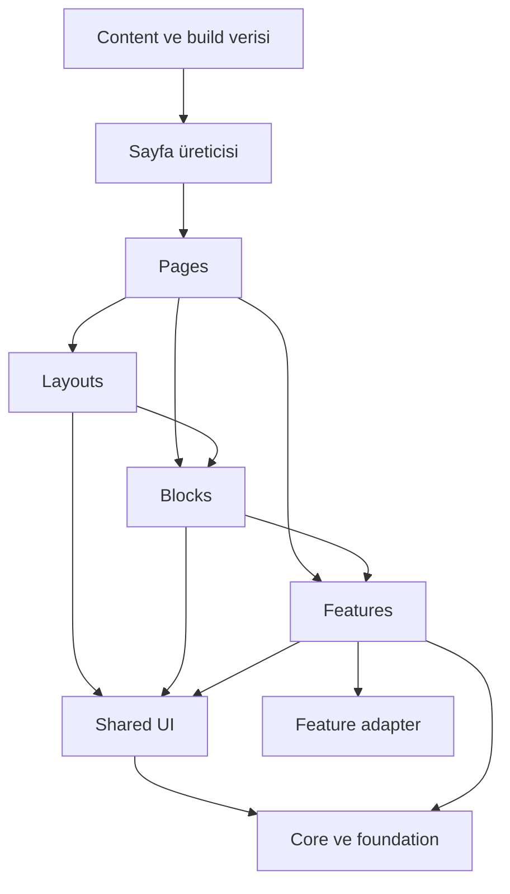

# Çok Amaçlı HTML Tema Framework’ü — Birleşik Yapılacaklar Planı (v2)

**Tarih:** 3 Ekim 2026  
**Sürüm:** v2. Bu belge, v1 mimari planı ile aynı gün yapılan inceleme raporunun birleştirilmiş hâlidir.  
**Kaynaklar:** [v1 plan (arşiv)](./reviews/theme-framework-2026-10-03/PLAN_v1_orijinal.md) · [İnceleme raporu](./MULTIPURPOSE_THEME_FRAMEWORK_INCELEME_RAPORU.md) · [kanitlar.json](./reviews/theme-framework-2026-10-03/kanitlar.json) · [tamamlama-olcumleri.json](./reviews/theme-framework-2026-10-03/tamamlama-olcumleri.json)  
**Temel:** Bu deponun mevcut Webpack 5 + Pug + SCSS + Bootstrap parçaları + saf JavaScript yapısı.  
**Durum:** Bu plan uygulamanın kapsamı ve kabul ölçütleri için kaynak belgedir. Uygulama başlamıştır; gerçekleşen işler ve açık kabul maddeleri [uygulama durum kaydında](./FRAMEWORK_IMPLEMENTATION_STATUS.md) tutulur. v1’deki mimari kararlar korunur; inceleme bulguları (R01–R17) ve kararlar (K1–K10) bu plandaki fazlara, iş kartlarına ve kabul şartlarına bağlanır.

**Hızlı erişim:** [Karar](#1-karar-ve-değişmeyen-mimari) · [Doğrulanmış mevcut durum](#2-doğrulanmış-mevcut-durum) · [Verilecek kararlar](#3-faz-0da-verilecek-kararlar-k1k10) · [Sözleşmeler](#4-mimari-sözleşmeler) · [Fazlar](#5-faz-planı) · [İlk iş kartları](#first-15-work-cards) · [Kabul matrisi](#7-kabul-ve-kalite-matrisi) · [Geçiş haritası](#8-geçiş-haritası) · [İzlenebilirlik](#12-bulgu--iş-izlenebilirliği)

---

## 0. Bu belge nasıl okunur

- **Yapılacak iş** fiil cümlesiyle yazılır ve bir faza bağlıdır. Her işin yanında kaynağı vardır: `[v1 §x]` plandan, `[Rxx]` inceleme bulgusundan, `[Kx]` karardan geliyor.
- **Kabul** satırı, o faz “bitti” denmeden önce geçmesi gereken kontroldür. Tek bir otomatik skor kabul kanıtı sayılmaz.
- **P1** bulgular (R01–R05) ilgili işin kabulüne girmeden o işe başlanmaz. **P2** bulgular (R06–R17) ilgili fazın kabulüne eklenir.
- Tahminler teslim sözü değildir; mimari pilot sonunda yeniden tahmin yapılır.

---

## 1. Karar ve değişmeyen mimari

**Karar:** Mevcut Webpack + Pug + SCSS + saf JavaScript temeli korunur. Proje; aynı çekirdekten kurumsal, ajans, SaaS, portfolyo, yayın, mağaza ve yönetim paneli sayfaları üretebilen, kaynakları düzenlenebilir bir çok amaçlı HTML tema framework’üne büyütülür. İnceleme, mimariyi değiştirmeyi gerektiren bir engel bulmadı; en büyük risk araç davranışlarının ve modüller arası sözleşmelerin yoruma bırakılmasıdır. Bu yüzden önce sözleşmeler netleştirilir, sonra dikey pilotla uygulanır.

| Alan | Karar | Gerekçe |
| --- | --- | --- |
| Render modeli | Derleme sırasında çok sayfalı HTML; her adres kendi belgesi | Mevcut yapıyla uyumlu; doğrudan URL, SEO, statik hosting |
| Template | Pug; inheritance, include, mixin | Çalışan altyapı ve mevcut sayfalar |
| Stil | SCSS kaynak + CSS custom properties + küçültülmüş çıktı | Düzenlenebilir kaynak; marka ve renk şeması desteği |
| Tarayıcı kodu | ES module kaynaklı saf JavaScript; framework runtime yok | Küçük, bağımsız etkileşimler |
| Build | Webpack ve mevcut `pug-plugin`; alternatif bundler ayrı ADR | İlk aşamada araç değişim maliyeti taşınmaz |
| Görsel bileşenler | Atomic Design ile sınıflandırılmış ortak UI | Parça büyüklüğü ve tekrar kullanımı okunur olsun |
| İşlevler | Kullanıcı yeteneğine göre feature klasörleri | Sepet, filtre, giriş, fiyatlandırma kendi sorumluluğunu taşır |
| Sayfalar | Layout + blok + feature bileşimi; tek `page.json` kaydı | Sayfa dosyası içerik ve yerleşimi anlatır |
| Tema ürünü | Marka preset’i + blok varyasyonu + çok sayfalı demo paketi | Renk değişiminin ötesinde tutarlı site aileleri |
| Özelleştirme | Açık token, mixin, event ve adapter sözleşmeleri | Kullanıcı çekirdek dosyaları değiştirmek zorunda kalmasın |

**Kapsam dışı (ilk sürüm):** React/Vue, istemci router, Pug runtime render, mikro frontend, npm workspace bölme, görsel page builder, service worker, tam CMS entegrasyonu. Bunlar somut ihtiyaç ve ölçüm oluştuğunda ayrı ADR ile ele alınır.

**Korunacak güçlü kararlar (incelemeden):** sayfa kaydını tek doğruluk kaynağı yapmak; output’u route’tan türetmek; SPA router olmadan gerçek HTML pagination; sepeti görünür DOM’dan ayırmak; `@use`’un farklı entry’ler arasındaki tekrarı çözmediğini kabul edip CSS sahipliğini önceliklendirmek; Sass/Bootstrap geçişini mekanik import değişimine indirgememek; no-JS, çoklu instance, cleanup, klavye ve focus davranışını component API’sine dahil etmek; daha fazla demo yerine iç sayfaları tamamlanmış iki marka üzerinden tekrar kullanımı sınamak; mevcut working tree değişikliklerini koruyarak küçük migration adımları atmak.

---

## 2. Doğrulanmış mevcut durum

İki ayrı ortamda alınan izole production build aynı sonucu verdi: **11 HTML, 11 CSS, 10 JS; 0 hata, 0 uyarı.** Webpack `5.111.1`, Pug Plugin `5.3.0`, Dart Sass `1.67.0`. Tarayıcı testi, Lighthouse ve hosting davranışı ölçülmedi.

### 2.1. Yapısal borçlar (kaynak koddan)

| Tespit | Kaynak | Yapılacak | Faz |
| --- | --- | --- | --- |
| Production’da `optimization.minimize: false` | `webpack.config.js:15` | JS minimization’ı aç; CSS zaten Sass tarafından compressed çıkıyor, CSS politikasını ayrı yaz [R11] | 1 |
| 11 sayfa tek config içinde elle sıralı | `webpack.config.js:24` | Şema doğrulanan manifest adaptörü [v1 §7] | 1 |
| `publicPath: "/"` ve `require('@images/...')` köke sabit | `webpack.config.js:11`, `header.pug:13` | `siteUrl/basePath/assetBase` ve `route()` yardımcısı [v1 §8.1] | 1 |
| Görsel çıktıları yalnız dosya adına dayanıyor | `webpack.config.js:12` | Tür klasörü + hash + benzersiz ad [v1 §11.4] | 1 |
| Her sayfa SCSS’i `main.scss`’i yeniden derliyor | `index.scss:1`, `_auth-shared.scss:1` | Core/theme/layout/page sahipliği [v1 §10.1] | 2 |
| Ortak CSS’in ~%91’i Bootstrap; şablonda yalnız `container`, `nav-link/nav-item`, `list-unstyled`, `my-0` kullanılıyor | `custom-bootstrap.scss` (103.987 B ham / 14.845 B gzip) | Korunan Bootstrap yüzeyini daralt [R15, K2] | 2 |
| Tek layout tüm sayfalara header/footer ekliyor | `base.pug:13` | Document + site/auth/dashboard/storefront/docs layout’ları [v1 §12.1] | 2 |
| Ortak JS, sayfanın `Base()` çağırmasına bağlı; `/markdown/` çıktısında script yok | `base.js:4`, `markdown/index.pug` | Shell script’i layout yüklesin [v1 §9.1, R01] | 2 |
| Header storage erişimi korumasız; `document` dinleyicileri temizlenmiyor | `header.js:26–37, 42, 44` | Güvenli storage, idempotent mount, `destroy()` [v1 §9.2] | 2 |
| Mobil menü CSS ile gizli; no-JS’te erişilemez | `header.scss:55` | No-JS navigasyon [v1 §9.3] | 2 |
| Koyu tema `body.theme-dark` + Sass sabitli override’lar | `variables.scss:47`, `base.scss:82–85`, `header.scss:62` | `html[data-color-scheme]` + token modeli; eski sınıf/anahtar geçişi [v1 §10.2, R04, R12] | 2 |
| Google Fonts derlenmiş CSS içinden `@import url()` ile | `main.scss:4` | Yerel WOFF2, subset, `font-display` [v1 §11.4] | 2 |
| `html lang="tr"` sabit; docs/templates/components/store İngilizce | `base.pug:2` | `lang/dir` sayfa kaydından; mevcut sayfaların locale kararı [K10] | 1–2 |
| UI Library tek büyük demo (548 / 673 / 1786 satır) | `views/components/*` | Katalog gerçek `ui` modüllerini tüketsin [v1 §14.1] | 3 |
| Sekme, toast, parola gösterme kodları tekrarlı | `index.js`, `components.js`, `dashboard.js`, `auth/*.js` | Ortak controller’lar [v1 §12.2] | 3 |
| Üç auth formu `action="#" method="post"`; `Base()` hata verirse submit handler bağlanmıyor | `login.pug:33`, `login.js:3→46` | Demo formun güvenli temel davranışı [R05, K4] | 3 |
| Sepet ürünleri görünür DOM’dan topluyor, görünmeyen ID’leri siliyor; `innerHTML` ile render | `store.js:17–39, 147–151, 153–175` | Katalog repository’si, sepet modeli, güvenli DOM yazımı [v1 §8.4, R08] | 4 |
| Storefront tokenlarında light/dark tamamlanmamış | `store.scss:3` | Mağaza tema kabul matrisine girer | 4–5 |
| İki lockfile (`package-lock.json` 02:57, `yarn.lock` 03:32); README Yarn | kök | Tek paket yöneticisi ve Node sürümü [K7] | 0 |
| 22 değişmiş + 11 izlenmeyen dosya commit’siz; `.gitignore` yalnız `node_modules`, `dist` | `git status` | Baseline commit/etiket; `.generated/`, `release/` ignore [R17] | 0 |

### 2.2. Üretilmiş çıktıdaki hatalar

| Hata | Yer | Faz |
| --- | --- | --- |
| `/auth/register/` → `/terms/` hedefi üretilmiyor | `register.pug:67` | 1 |
| `/dashboard/` içinde 12 hedefsiz fragment (`#customers`, `#invoices`, `#settings`, `#upgrade`, beş `#project-*`, üç `*-report`) | `dashboard.pug` | 1 |
| İç linklerin çoğu eğik çizgisiz (`/components` ×9, `/templates`, `/dashboard`, `/commerce` ×4, `/marketing`, `/markdown`, `/auth/login` ×3); aynı hedef için `/auth/login/` de var | header, footer, templates, markdown | 1 [R16, K3] |
| `404.html` üretilmiyor | entry listesi | 1 |
| Markdown sayfasının CSS’i `style.<hash>.css` adıyla çıkıyor | `markdown/style.scss` | 1 |
| `devtool` tanımsız; production map politikası yok | `webpack.config.js` | 1 |

### 2.3. Başlangıç ölçümleri (gzip, KiB = 1.024 byte)

| Sayfa | CSS | JS |
| --- | ---: | ---: |
| `/` | 20,20 | 1,82 |
| `/about/` | 17,18 | 1,05 |
| `/markdown/` | 19,00 | 0,00 |
| `/components/` | 22,18 | 5,89 |
| `/templates/` | 17,61 | 1,19 |
| `/auth/login/` | 18,84 | 1,58 |
| `/auth/register/` | 18,87 | 1,82 |
| `/auth/forgot-password/` | 18,88 | 1,37 |
| `/dashboard/` | 21,32 | 2,35 |
| `/commerce/` | 23,34 | 5,03 |
| `/marketing/` | 21,29 | 1,78 |

11 CSS dosyasının ilk 113.905 karakteri birebir aynı ve `main.scss`’in tek başına derlenmiş hâline eşit (111,24 KiB ham, 16,83 KiB gzip). Bu, sayfalar arasında yeniden indirilen ortak kaynağın somut kanıtıdır; Faz 2’nin baseline’ı budur.

### 2.4. Demo işlevlerinin sınırı

| Alan | Şu an | Ürünleşme adımı |
| --- | --- | --- |
| Auth | Validation, parola gösterme, pending, demo mesajı | Ortak form feature’ı; demo/bağlı adapter; JS yokken güvenli form [R05] |
| Commerce | DOM’dan ürün, filtre/sıralama, localStorage sepet, quick view | Koleksiyon verisi, detay sayfaları, pagination, DOM’dan bağımsız sepet |
| Checkout/newsletter | Demo geri bildirimi | Ayrı adapter; demo/bağlı ayrımı |
| Dashboard | Sidebar, sekmeler, tablo filtresi, dialog | Bağımsız widget’lar; veri adapter’ları; hedefsiz fragment’ların düzeltilmesi |
| Ana sayfa starter formu | Bilgi mesajı | CLI scaffold rehberi |
| Pagination örneği | UI Library’de görsel düğmeler | Gerçek adreslere giden build-time sayfalama |

Statik teslim gerçek hesap, ödeme, e-posta veya sunucu erişim kontrolü sağlamaz; bunlar adapter üzerinden bağlanır. Statik dashboard dosyalarının gizliliği istemci JavaScript’iyle sağlanamaz.

---

## 3. Faz 0’da verilecek kararlar (K1–K10)

Bu kararlar uygulamacıya bırakılmaz; her biri kısa bir ADR olarak `docs/adr/` altına yazılır. Önerilen varsayılan incelemenin kanıtına göre seçilmiştir.

| # | Karar | Önerilen varsayılan | Kapattığı bulgular | ADR |
| --- | --- | --- | --- | --- |
| K1 | Belge başına JS runtime politikası | `runtimeChunk: 'single'` (kurulu araçta doğrulandı); alternatif: tek page entry shell’i import eder | R01 | ADR-001 |
| K2 | Korunan Bootstrap yüzeyi | `reboot` + `containers` + `grid`; `utilities/api` ve `helpers` çıkar ya da `$utilities` map’i kullanılan sınıflara indirilir; `.nav-link/.nav-item` ya Bootstrap `nav` ile kalır ya `ui-*` olur | R04, R15 | ADR-002 |
| K3 | Site içi link biçimi | Daima sondaki eğik çizgiyle; yalnız `route()` üzerinden; literal `href="/..."` yasak | R16 | ADR-003 |
| K4 | Demo ve bağlı formların temel davranışı | Demo: disabled `fieldset`, controller bağlanınca etkinleşir, statik açıklama görünür; bağlı: gerçek `action/method` + sunucu doğrulaması | R05 | ADR-004 |
| K5 | Build profilleri ve teslim HTML biçimi | `development` / katalog preview (noindex, crawler okuyabilir) / müşteri production / okunabilir release HTML | R07, R13 | ADR-005 |
| K6 | Milestone adları ve v1 kapsamı | “Mimari pilot” (Faz 0–3, auth ailesi) ve “İlk tam demo” (Agency) ayrı; v1 = iki tam demo; üçüncü demo kapasiteye bağlı | R14 | ADR-006 |
| K7 | Paket yöneticisi, Node, lockfile | Yarn + `yarn.lock`; `package-lock.json` ayrı commit’te kaldırılır; Node sürümü `engines` ve `.nvmrc` ile sabit | §5, §14.3, R17 | ADR-007 |
| K8 | Yayın zamanı girdisi | `buildNow` parametresi, UTC, ISO-8601; reproducibility kontrolünde sabitlenir; ileri tarihli içerik için yeniden build gerekir | R09 | ADR-008 |
| K9 | Erişilebilirlik hedefi | WCAG 2.2 AA açık hedef; 44×44 px proje tasarım hedefi | R10 | ADR-009 |
| K10 | Mevcut dil karışıklığı ve locale prefix | Docs/templates/components/storefront locale kararı; `lang/dir` sayfa kaydından; `/tr/`, `/en/` prefix politikası baştan | §13.2 | ADR-010 |

Ek Faz 0 kararları (ADR gerektirmez, Faz 0 teslimine yazılır): demo/sayfa/veri önceliği şeması [R07], adapter sonuç modeli [R08], output sahiplik listesi [R09].

---

## 4. Mimari sözleşmeler

Bu bölüm v1’in mimari içeriğini korur; her alt başlığın sonundaki **İnceleme ekleri** bulguların sözleşmeye işlenmiş hâlidir.

### 4.1. Katmanlar ve bağımlılık kuralları

| Katman | İçerik | Örnek |
| --- | --- | --- |
| Foundation | Token, reset, grid, tipografi, yardımcı stiller | Spacing scale, container, focus ring |
| Atom | Küçük görsel/semantik parça | Button, input, badge, icon |
| Molecule | Birkaç atomdan ortak desen | Form field, search field, pagination |
| Organism | Domain’den bağımsız büyük UI | Tabs, dialog, data table, navigation |
| Feature | Kullanıcı yeteneği ve state’i | Cart, catalog filter, sign-in, newsletter |
| Block | Sayfaya yerleştirilebilir içerik bölümü | Hero, pricing, testimonials, FAQ, CTA, site-header |
| Layout | Belge içindeki ortak çerçeve | Site, auth, dashboard, storefront, docs, minimal |
| Page | URL’ye karşılık gelen kompozisyon | About, product detail, blog archive |
| Demo pack | Ortak marka/menü/içerik kullanan sayfa ailesi | Agency, SaaS, editorial, commerce |



- `pages` başka sayfanın iç dosyasını import etmez. `ui` feature veya page import etmez. `features` birbirinin özel dosyasına erişmez; koordinasyon page/block seviyesinde. `layouts` domain mantığı taşımaz; header’daki sepet özeti slot/block ile gelir. `core` sayfa, tema ve domain adı bilmez. `themes` davranış uygulamaz. Build verisi ile tarayıcı verisi ayrıdır.
- `product-card` ilk etapta `features/catalog/ui/` içinde kalır; iki feature aynı modele ihtiyaç duyunca `domain/product/` açılır. Boş `entities/services/managers` açılmaz.

**İnceleme ekleri:** `Layouts → Blocks` kenarı eklendi; site-header bir block olduğu için layout block kullanır. **Mount sahipliği kuralı:** bir `data-component`/`data-feature` root’unu yalnız bir giriş (shell ya da page) başlatır; hangi root’u kimin taradığı layout sözleşmesinde yazılır [R01]. Import yolu kısıtı (`pages → ui iç dosyası` gibi) Faz 1’de basit lint kuralı olarak girer, “zamanla” beklenmez.

### 4.2. Hedef klasör yapısı

```text
html-boilerplate/
├── package.json · yarn.lock · .nvmrc        # tek lockfile; Node sabit [K7]
├── .browserslistrc                           # repo kökünde; config/ altında değil [R06]
├── webpack.config.js                         # ince giriş; config/build modüllerini çağırır
├── config/  site.config.cjs · build.config.cjs · schemas/
├── build/   webpack/ · pages/ · collections/ · helpers/ · generators/
├── scripts/ create-page.mjs · create-component.mjs · create-demo.mjs · package-release.mjs
├── qa/      check-dist.mjs · link-check · fixtures   # Faz 1’den itibaren, “ileride” değil [R10]
├── docs/    adr/ · rehberler · migration
├── src/
│   ├── core/      runtime/ · dom/ · storage/
│   ├── styles/    tokens/ · tools/ · foundation/ · utilities/ · vendor/ · core.scss
│   ├── ui/        atoms/ · molecules/ · organisms/   (pug + _scss + js + docs.md)
│   ├── features/  auth/ · catalog/ · cart/ · newsletter/ · pricing/
│   ├── blocks/    hero-split/ · pricing-grid/ · faq/ · site-header/ …
│   ├── layouts/   document.pug · site/ · auth/ · dashboard/ · storefront/ · docs/ · minimal/
│   ├── pages/     home/ · auth/{login,register,forgot-password}/ · commerce/ · blog/ · …
│   │              (her sayfa: page.json · page.pug · page.scss · page.js? · page.data.cjs?)
│   ├── themes/    default/ · corporate/ · editorial/ · commerce/
│   ├── demos/     agency/demo.json · saas/demo.json
│   ├── content/   posts/ · products/ · locales/
│   ├── data/ · assets/{images,icons,fonts}/
├── public/                                   # dönüşmeden kopyalanan dosyalar
├── .generated/                               # build türevi; .gitignore [R17]
├── dist/                                     # yayın çıktısı
└── release/                                  # teslim paketleri; .gitignore [R17]
```

`views → pages`, `scss → styles`, `js → core/ui/features` geçişi tek seferde yapılmaz; eski alias’lar köprü olur. Eski entry’ler ile yeni kayıtlar aynı manifestte birleşir ve çakışma kontrolünden geçer.

### 4.3. Bileşen sözleşmesi

Her gerçek bileşenin `*.docs.md` dosyasında: amaç, template API (props, varsayılan, slot), görünüm (variant/size/density, public CSS değişkenleri), durumlar, semantik/ARIA, davranış (klavye, focus, Escape, dışarı tıklama), JS olmadan davranış, çoklu kullanım ve ID politikası, lifecycle (`mount(root, options)` / `destroy()`), event isimleri ve payload, asset sahipliği.

```pug
mixin button(options = {})
  - const { label, variant = 'primary', type = 'button', disabled = false } = options
  button.ui-button(class=`ui-button--${variant}` type=type disabled=disabled)&attributes(attributes)
    if block
      block
    else
      = label
```

Kurallar: navigasyon için ayrı link bileşeni; kullanıcı/CMS metni escaped; `!=` yalnız belgelenmiş sanitization sınırında; görünüm sınıfları `ui-*`, `block-*`, `feature-*`; JS görünüm sınıfına değil `data-component`, `data-action` ve ARIA’ya bağlanır; mevcut `.button`, `.form-*`, `.status-badge` alias ile korunur. Yeni soyutlama: iki bağımsız kullanımda çıkar, üçüncüde doğrula.

**İnceleme ekleri:** Variant/props doğrulaması build’de çalışan `assertProps` yardımcısıyla yapılır; hatalı variant kaynak dosya/bileşen bilgisiyle build’i durdurur [R08]. `&attributes` ile hangi attribute’ların dışarıdan ezilebileceği (class birleşir, `type`/`disabled` ezilir) API’de yazılır. `innerHTML` ile veri yazımı lint ile yasaklanır; mevcut `store.js` deseni geçişte `textContent`/template cloning’e döner.

### 4.4. Sayfa kaydı, manifest ve HTML üretimi

Her somut sayfa bir `page.json` kaydıdır; koleksiyon sayfaları aynı normalize formatta üreticiden gelir; hepsi `.generated/pages-manifest.json`’da birleşir.

```json
{
  "id": "agency.about.tr",
  "blueprintId": "agency.about",
  "translationKey": "agency.about",
  "route": "/demos/agency/about/",
  "source": "src/pages/agency/about/page.pug",
  "layout": "site",
  "theme": "corporate",
  "locale": "tr",
  "direction": "ltr",
  "title": "Hakkımızda — Atlas Ajans",
  "description": "Atlas Ajans ekibi, yaklaşımı ve uzmanlık alanları.",
  "data": "src/pages/agency/about/page.data.cjs",
  "styles": ["src/pages/agency/about/page.scss"],
  "script": "src/pages/agency/about/page.js",
  "head": { "preload": [], "jsonLd": null },
  "navigation": { "group": "agency-main", "label": "Hakkımızda", "order": 20 },
  "gallery": { "category": "agency", "preview": true },
  "robots": "index,follow"
}
```

- `route` basePath hariç kanonik yoldur; `output` ondan türetilir (`demos/agency/about/index.html`). İkisi elle yönetilmez.
- `layout` alanı, `.generated/` altında o layout’u `extends` eden bir wrapper üretir; `page.pug` wrapper’ın içerik alanına include edilir ve tekrar `extends` yazmaz. Eski `extends` sayfaları geçişte legacy adaptörle doğrudan entry kalır; **her iki tür aynı manifest çıktısını üretir.**
- Kayıtlardaki yollar repo köküne göredir; wrapper yazılırken alias’a (`@pages`, `@layouts`, `@images`) çevrilir; ham `src/...` yolu wrapper’a kopyalanmaz.
- Feature listesi elle tutulmaz; page JS’indeki import’lar davranış bağımlılığıdır; CSS bağımlılıkları SCSS girişlerinin sahipliğindedir.
- Navigation ve galeri kayıtları manifestten türetilir; header ve footer’daki elle yazılmış nav listeleri kaldırılır.

**Derlemenin reddedeceği durumlar:** aynı ID/route/output (büyük-küçük harf farkı dahil; macOS’ta geçip Linux’ta 404 olmasın); kaynak dışına çıkan yol; olmayan source/layout/theme/data; eksik title/locale; aynı slug’a dönüşen iki içerik; geçersiz tarih; seçili demo paketinde olmayan iç hedefe giden menü linki; **aynı output’u isteyen iki üretici** (page, public kopyası, sitemap/robots/search generator) [R09].

**İnceleme ekleri:**

- **Asset yolu kuralı [R02]:** generated entry’den kullanılan bütün Pug page/block/UI asset referansları (`src`, `srcset`, favicon, veri içindeki görsel) kaynak alias’ı veya doğrulanmış asset helper’ı üzerinden verilir; literal `./icon.svg` yasak. Scaffold üretir, lint uygular. Kurulu plugin’de doğrulandı: `./icon.svg` `.generated/` altında aranıp build kırılıyor, `@card/icon.svg` çalışıyor.
- **Watch sözleşmesi [R03]:** tek üretim fonksiyonu hem ilk build’de hem rebuild’de çalışır; kayıt ekleme/silme/yeniden adlandırma, JSON/Markdown içerik, nested CJS veri bağımlılıkları izlenir; `.generated` kendi üretimini sonsuz rebuild’e çevirmez; yeni manifest doğrulanıp derleme başarılı olduktan sonra eski çıktılar sahiplik listesine göre silinir; bozuk içerik son çalışan çıktıyı yarıda bırakmaz.
- **Head slot’ları:** include edilen `page.pug` içinde `block` çalışmayacağı için preload, JSON-LD ve ek stylesheet yalnız kayıt alanlarından gelir; alan listesi şemada tanımlıdır.
- **Slug kuralı:** Türkçe karakter dönüşümü (ı/İ, ş, ğ, NFC) ve küçük harf politikası tek yardımcıda; `check:content` uygular.
- **Zaman girdisi [K8]:** koleksiyon üretimi `buildNow` alır; aynı kaynak + lockfile + profil + zaman aynı checksum’ları üretir.
- **Veri önceliği [R07]:** site → theme → demo → page → content → custom alanları için alan bazlı öncelik tablosu; `id`, normalize route ve output derleyici tarafından yönetilir, spread ile ezilmez.

### 4.5. Routing, URL ve sayfalama

| URL | Üretilen dosya | Amaç |
| --- | --- | --- |
| `/` | `dist/index.html` | Ana sayfa |
| `/about/` | `dist/about/index.html` | Sabit içerik |
| `/blog/` · `/blog/page/2/` | `dist/blog/index.html` · `dist/blog/page/2/index.html` | Arşiv |
| `/blog/ornek-yazi/` | `dist/blog/ornek-yazi/index.html` | Detay |
| `/blog/category/design/` | `dist/blog/category/design/index.html` | Kategori |
| `/commerce/` · `/commerce/page/2/` · `/commerce/product/desk-lamp/` | directory-index | Katalog ve ürün |
| `/404.html` | `dist/404.html` | Hosting’e tanıtılacak hata belgesi |

- Üç ayrı config: `siteUrl` (canonical/OG/sitemap origin), `basePath` (`/` veya `/preview/theme/`), `assetBase` (normalde basePath altı, isteğe göre CDN).
- `route(pageId, params)` site içi linkleri üretir; `publicPath` yalnız asset’i çözer. Alt dizinde çift prefix ve `//` oluşmadığı doğrulanır.
- `/about` → `/about/` yönlendirmesi ve 404 durum kodu hosting adaptöründe; bilinmeyen adres ana sayfaya rewrite edilmez. `file://` ayrı profil, ilk sürümde yok; yerel HTTP preview komutu belgelenir.
- Koleksiyon üreticisi: deterministik sıra (`publishedAt:desc`, `id:asc`); `pageSize` dilimleme; `/page/1/` üretilmez; boş koleksiyonda tek boş durum sayfası; silinen kaydın çıktısı temizlenir; pagination `nav` + gerçek `<a href>`, `aria-current="page"`, olmayan yön için `href="#"` yok; görünür sayfa penceresi (ör. 1 … 4 5 6 … 20) tanımlı.
- Filtre/arama/pagination ayrımı: SEO arşivi build’de HTML; ekran içi filtre kapsamı açıkça görünür; küçük katalogda build’de üretilen sınırlı arama indeksi; büyük katalogda adapter. URL query state yerel filtre state’idir; `popstate` ile geri kurulur; site çapında router yok.
- Sepet: `productId`, `variantId`, miktar; katalog repository’si bütün demo ürünlerini bilir; görünmeyen ürün silinmez; sürümlü anahtar `theme:commerce-demo:cart:v1`; demolar arası sepet karışmaz; fiyat/stok otoritesi sunucuda.

**İnceleme ekleri:** **Tek link biçimi [K3/R16]:** bütün iç linkler sondaki eğik çizgiyle ve `route()` üzerinden; `check:dist` eğik çizgisiz veya hedefsiz iç linki hata sayar; hosting kabulünde `/about` isteğinin davranışı belgelenir. `pageSize` değişince yetim `/page/N/` çıktıları R03’teki sahiplik mekanizmasıyla temizlenir. **Repository hata ayrımı [R08]:** ağ hatası “ürün yok” ile karıştırılmaz; katalog isteği başarısız oldu diye sepet boşaltılmaz.

### 4.6. JavaScript runtime

- Layout ortak shell script’ini yükler; page JS yalnız ihtiyaç duyduğu controller/feature’ı import eder; boş `page.js` zorunlu değil; UI kataloğu üretimle aynı modülleri kullanır.
- Controller sözleşmesi: `mount(root, options)` instance döndürür; selector’lar root içinde; WeakMap ile tekrar mount engellenir; async mount sırasında ikinci çağrı aynı instance’a yönelir; `destroy()` event/observer/timer/kayıt temizler ve tekrar mount’u engellemez; belgelenmiş `CustomEvent` (`cart:change`, `dialog:close`); `idPrefix` ile çoklu instance; bir widget hatası diğerlerini durdurmaz; async durumlar pending/error/empty ve iptal edilebilir.
- Temel davranış: içerik ve linkler HTML’de hazır; menü JS’siz erişilebilir; sekme panelleri temel HTML’de okunur; `<details>` uygun yerde; demo form gerçek işlem izlenimi vermez; token/gizli veri HTML veya localStorage’a girmez; DOM’a veri `textContent`/template cloning ile yazılır.
- Dynamic import yalnız sabit eşlemeden; DOM’dan gelen dosya adı yürütülmez.

**İnceleme ekleri:** **Runtime politikası [K1/R01]:** shell ve page aynı stateful modülü kullandığında tek instance oluşmalı. Kurulu araçla doğrulandı: varsayılan runtime’da `shared.js` iki kez değerlendirilip iki kez mount ediyor; `runtimeChunk: 'single'` ile bir kez. Kabul, yalnız tek bundle içinde tekrar-mount testi değil, iki entry ile çift instance testidir. `document` seviyesindeki dinleyiciler tek `AbortController` sinyaline bağlanır. Production’da `console` politikası minification kararıyla birlikte yazılır. **Adapter sözleşmesi [R08]:** `getByIds(ids, { signal })`, `submit(payload, { signal })`; sonuçlar başarı / alan hatası / genel hata / iptal / bulunamadı; geç tamamlanan eski istek yeni sonucu ezmez; `destroy()` sonrası UI güncellenmez. Public JS API’leri JSDoc ile belgelenir; TypeScript geçişi şart değil.

### 4.7. SCSS, CSS çıktıları ve tema

Yükleme sırası: `core.css → theme.css → layout.css → page.css → custom.css`.

| Çıktı | Sahip olduğu stiller |
| --- | --- |
| `core` | Reset, korunan Bootstrap yüzeyi [K2], temel type, semantic token varsayılanları, küçük ortak primitive’ler |
| `theme` | Marka ve light/dark token değerleri; font tanımları |
| `layout` | Header/sidebar/footer ve o layout’un yerleşimi |
| `page` | Kullanılan ek UI/feature/block stilleri ve kompozisyon |
| `custom` | Tema kullanıcısının belgelenmiş override alanı |

- Bir partial’ın sahibi nettir; `page.scss` core’u import etmez. Aynı component CSS’inin iki page çıktısında bulunması başlangıçta kabul; aynı belgede iki kez bulunması yasak. Ortak stiller için sahiplik listesi tutulur, build çıktısı bu listeyle kontrol edilir. `@use` farklı entry’ler arası tekrarı çözmez.
- Token katmanları: palette/scale → semantic (`--color-surface`, `--space-*`) → yalnız gerektiğinde component token. Tema eksenleri: marka, renk şeması (light/dark/system), yoğunluk, yön (`dir`, logical properties), kompozisyon.
- Renk şeması/marka durumu `html` elemanında (`data-theme`, `data-color-scheme`); açık kullanıcı seçimi → sistem tercihi → site varsayılanı; storage okunamazsa sayfa çalışır; ilk boyama öncesi küçük sabit başlangıç script’i, inline ise CSP hash’i son üretilmiş byte’lardan.
- Sass: proje modülleri kademeli `@use/@forward`; `styles/tools` CSS üretmez; Bootstrap import sırası `styles/vendor` içinde; Bootstrap JS eklenmez. `@import` Dart Sass 1.80’den itibaren deprecated; kurulu 1.67.0’da uyarı yok.
- Cascade: düşük specificity, ID’siz seçici, mobile-first, ortak breakpoint tokenları, `prefers-reduced-motion` politikası; `@layer` ve PurgeCSS ileriki iş.

**İnceleme ekleri:** **Bootstrap kapsamı önce daraltılır [K2/R15]:** Faz 2 “core.css’i ayır” ile değil, korunan Bootstrap yüzeyini listelemekle başlar; ölçüm core gzip boyutu başta ve sonda aynı yöntemle raporlanır; korunan listede olmayan Bootstrap sınıfı şablonda görünürse lint uyarır. **Bootstrap köprüsü [R04]:** renk/font utility’si korunuyorsa semantic token → ilgili `--bs-*` ve RGB token eşlemesi; `[data-bs-theme]` aynı çözümlenmiş state’ten türetilir; native kontroller için CSS `color-scheme`; tercih edilen `system` ile uygulanan `light/dark` ayrı tutulur. Koyu tema için Sass sabitli override’lar (`base.scss:82–85`, `header.scss:62`) token modeline taşınır. `quietDeps` yalnız vendor için; proje uyarıları görünür kalır. **Eski public yüzey geçişi [R12]:** `body.theme-dark`, `theme` storage anahtarı ve `atelier-store-cart-v1` için okuma/taşıma kuralı ve kaldırma tarihi belgelenir.

### 4.8. Production build ve asset hattı

1. Config’i mode’a göre üreten factory.
2. Production’da `minimize: false` kaldırılır; JS minimizer çalışır; `console`/lisans yorumu politikası yazılır.
3. **CSS politikası ayrı iş [R11]:** Sass production çıktısı zaten `compressed` (`sass-loader` production davranışı); ek CSS minifier eklenecekse plain/vendor CSS kapsamı, ek kazanç ve build maliyetiyle gerekçelenir; eklenen minimizer Webpack’in JS minimizer’ını devre dışı bırakmaz.
4. HTML minification kurulu plugin sürümünün API’siyle denenir; `pre/code`, attribute ve erişilebilirlik metinleri korunur; release HTML profili okunabilir üretilebilir [K5].
5. `devtool`: development’ta okunabilir map; production map politikası açık.
6. Build raporu: sayfa bazlı asset listesi, ham/gzip boyutları, ortak içerik tekrarı, **baseline’a göre yüzde değişim** [R11].
7. Entry adları sahiplik gösterir (`assets/css/pages/agency-about.<hash>.css`); `page.scss` adı çıktıda çakışmaz; markdown’ın `style.<hash>.css` durumu düzelir.
8. Cache/chunk: hash’li asset uzun cache, HTML kısa; `splitChunks/runtimeChunk` ayarı plugin’in HTML’de script sırasını doğru ürettiğiyle birlikte doğrulanır [K1]; her HTML bağımsız açılabilir; gzip/brotli minification’dan ayrı aşama.
9. Görsel/font: aynı `hero.jpg` adlı iki demo çakışmaz; AVIF/WebP + `srcset/sizes` seçili demo görselleriyle başlar; boyut/aspect-ratio; LCP görseli lazy değil; SVG sprite; **yerel WOFF2, subset, `font-display`, Türkçe karakter kapsamı; Google Fonts `@import` kaldırılır** (Faz 2); `public/` yalnız hash’siz kopya için.

### 4.9. Layout, blok ve demo kataloğu

Layout ailesi: Document, Site, Auth, Dashboard, Storefront, Docs, Minimal (404/maintenance). Boolean yığını yerine amaca uygun layout ve slot.

| Öncelik | Kapsam | İlk hedef |
| --- | --- | --- |
| P0 | Button/link, input/field, select, checkbox/radio, badge, alert, card | Mevcut tekrarları ortak sözleşmeye taşımak |
| P0 | Tabs, dialog, toast, disclosure, pagination | Klavye/focus/çoklu instance standardı |
| P1 | Breadcrumb, search, empty state, table, skeleton, progress | İç sayfalar ve veri durumları |
| P1 | Hero, feature grid, logo strip, stats, testimonial, pricing, FAQ, CTA | Marketing/kurumsal demolar |
| P1 | Product card, filter, cart drawer, quick view | Commerce ailesi |
| P2 | Gallery/lightbox, carousel, timeline, comparison, advanced table | İhtiyaç ve bütçeye göre |

| Sıra | Paket | Birlikte teslim edilecek sayfalar |
| --- | --- | --- |
| İlk tam demo [K6] | Agency / corporate | Home, about, services, service detail, projects, project detail, contact, 404 |
| v1 ikinci demo | **SaaS (ADR-006 ile seçildi)** | Home, features, pricing, FAQ, blog/article ve auth bağlantıları. Commerce bu sürümde korunan storefront pilotudur; üçüncü tam demo sonraki kapasite kararına bağlıdır. |
| Kapasiteye bağlı | Diğeri | — |
| Sonraki | Editorial, Portfolio, Dashboard | — |

Kapasite varsayımı: 2–3 demo, 20–30 page blueprint, 25–35 component. **Sayım birimleri [R14]:** blueprint, içerikten üretilen instance, layout ve tema varyantı ayrı sayılır; iki dil, dark mode veya renk farkı blueprint değildir. Mevcut dashboard ve commerce sayfaları v1’de “korunan örnek”tir, tam demo paketi değildir. **Demo profili [R07]:** katalog preview / tek müşteri sitesi / starter profilleri için ana sayfa, route mount’u (`/demos/agency/about/` → seçili demo build’inde `/about/` olup olmayacağı), dahil sayfalar ve indeksleme davranışı tablo olarak yazılır; seçili demo build’inde dışarı sızan menü linki build’i durdurur.

### 4.10. İçerik, SEO, dil ve erişilebilirlik

- İçerik modeli: makale (`id, slug, title, description, publishedAt, updatedAt, author, tags, cover, draft, locale`), ürün (minor unit + currency; `Intl` ile format), sayfa metadata (title, description, canonical, robots, OG, JSON-LD yalnız gerçek içerikle ve `</script>` kaçışıyla).
- Pagination sayfalarının kendi canonical’ı; yalnız üretilen ve yayınlanacak sayfalar sitemap’te; preview profili `noindex` ve crawler’ın okuyabildiği robots [R13]; gerçek yayın adresi build girdisi.
- Dil/RTL: `lang/dir` kayıttan; ortak metinler `content/locales`; prefix politikası baştan [K10]; dil değiştirici `translationKey` ile eş içeriğe gider; hreflang yalnız var olan karşılıklar arasında; RTL’de ikon, breadcrumb, tablo, sidebar, drawer kontrol edilir; tarih/sayı/para locale’den.
- Erişilebilirlik: semantik HTML önce; WAI APG pattern’leri; hedef WCAG 2.2 AA [K9]; kabul tablosuna ek olarak anlamlı görsellere metin alternatifi, 3:1 non-text contrast, %200 metin büyütme, 320 CSS px reflow, hata tanımlama/öneri akışı, auth’ta parola yöneticisi ve yapıştırma desteği [R10]; 44×44 px proje tasarım hedefi.

### 4.11. Dokümantasyon, CLI ve bağımlılık politikası

- Component kataloğu: canlı örnek ve HTML kaynağı aynı Pug’dan; props tablosu, state/variant, klavye, tema örnekleri; en az bir çoklu instance örneği; statik/enhanced karşılaştırması.
- Rehberler: kurulum ve sürümler; hazır HTML’yi düzenleme ile kaynaktan build; yeni sayfa/component/block/theme/demo; token/font/logo/menü özelleştirme; koleksiyon ve pagination; adapter bağlama; kök/alt dizin yayın, cache, 404; güncelleme/migration ve **kullanıcı-owned dosya sınırı** [R12].
- Komutlar (öneri): `yarn start`, `yarn build`, `yarn preview` (SPA fallback yok [R13]), `yarn build:demo <ad>`, `yarn create:page`, `yarn create:component` (alias asset kuralını üretir [R02]), `yarn create:demo`, `yarn check:content`, `yarn check:dist`, `yarn lint`, `yarn format:check`, `yarn package:release`.
- Bağımlılık: Webpack/Pug/pug-plugin/Sass korunur; CSS minifier gerekçeyle; PostCSS/Autoprefixer hedef tarayıcı gerekçesiyle; **schema validator Faz 1’den itibaren** (kütüphane opsiyonel, doğrulama zorunlu) [R08]; lint/format sabit sürüm; tarayıcı/a11y kontrolleri Faz 1–3’te development bağımlılığı [R10]; slider/chart/date picker opsiyonel adapter; framework/jQuery yok. `.browserslistrc` repo kökünde; “hedef liste”, “sözdizimi dönüşümü” ve “API fallback” ayrı kararlar; browserslist tek başına polyfill sağlamaz [R06].

---

## 5. Faz planı

### Faz 0 — Baseline, envanter ve sözleşmeler

**Amaç:** Mevcut durumu kaybetmeden kaydetmek; kavramları tek anlama indirmek.

| # | İş | Kaynak |
| --- | --- | --- |
| 0.1 | Çalışma ağacını olduğu gibi commit et; `baseline-2026-10` etiketi koy; `.gitignore`’a `.generated/`, `release/` ekle | R17 |
| 0.2 | K1–K10 kararlarını ADR olarak yaz | §3 |
| 0.3 | Paket yöneticisi/Node/lockfile kararını uygula; `package-lock.json`’ı ayrı commit’te kaldır | K7 |
| 0.4 | Route matrisi: 11 sayfanın URL, template, CSS, JS, layout ilişkisi; 2.2’deki hata listesi | v1 §17 |
| 0.5 | Başlangıç ölçümlerini etiketli commit’ten yeniden üret ve `docs/` altına kaydet | §2.3 |
| 0.6 | Dosya sahipliği haritası (§8) ve demo/sayfa/veri önceliği şeması | R07 |
| 0.7 | Milestone adları ve v1 kapsamını tek listeye yaz | K6, R14 |

**Teslim:** Baseline commit + etiket; ADR-001…010; route matrisi; ölçüm raporu; sahiplik haritası; v1 kapsam listesi.  
**Kabul:** `git status` temiz; aynı kavram iki belgede farklı anlam taşımıyor; hangi davranışın demo olduğu belli; ölçümler etiketli commit’ten yeniden üretilebiliyor.  
**Bağımlılık:** Yok.

### Faz 1 — Build ve MPA temeli

**Amaç:** Aynı 11 sayfayı yeni build sözleşmesi altında, root ve subpath profilleriyle üretmek.

**1A. Doğrulama deneyleri (üretim koduna girmeden önce):**

| # | İş | Kaynak |
| --- | --- | --- |
| 1.1 | Tek örnek sayfada runtime politikasını uygula ve iki entry ile tek instance testini geçir | K1, R01 |
| 1.2 | Tek örnek wrapper + alias asset ile farklı dizinlerden iki wrapper derle | R02 |
| 1.3 | Manifest watch prototipi: kayıt ekle/sil/yeniden adlandır, bozuk JSON ekle-düzelt | R03 |
| 1.4 | `.browserslistrc` kökte; CLI/build/Autoprefixer aynı listeyi okuyor | R06 |

**1B. Uygulama:**

| # | İş | Kaynak |
| --- | --- | --- |
| 1.5 | Config factory (development/production/profil) | v1 §11.1 |
| 1.6 | Page şeması + manifest adaptörü; legacy entry köprüsü; şema doğrulaması zorunlu | v1 §7, R08 |
| 1.7 | `siteUrl/basePath/assetBase` ve `route()`; template’lerdeki literal `/...` linklerini taşı; tek link biçimi | K3, R16 |
| 1.8 | Deterministik ve sahiplik gösteren çıktı adları; görsel/font tür klasörü + hash | v1 §11.2, §11.4 |
| 1.9 | JS minimization aç; CSS politikası ve `devtool` kararını yaz; `console` politikası | R11 |
| 1.10 | Output sahiplik kontrolü (page/public/sitemap/robots/release) ve `buildNow` girdisi | R09, K8 |
| 1.11 | `404.html`, `/terms/` hedefi (sayfa ya da linkin kaldırılması), dashboard fragment’larının button/gerçek hedef olarak düzeltilmesi | §2.2 |
| 1.12 | `qa/check-dist`: yerel link, fragment, eğik çizgisiz link, asset, duplicate ID, output çakışması; CI’a bağla | R10, R16 |
| 1.13 | `yarn preview` (SPA fallback yok) ve root + `/preview/theme/` smoke kontrolü | R13 |
| 1.14 | Import yolu lint kuralı (katman sınırları) | §4.1 |

**Teslim:** Aynı 11 sayfa + 404; root ve subpath profili; `check:dist` CI’da; build raporu.  
**Kabul:** Doğrudan iç URL açılır; asset’lar bulunur; JS gerçekte küçültülmüş; duplicate kayıt ve output çakışması build’i durdurur; kırık link/fragment envanteri sıfır; eğik çizgisiz iç link yok; shell+page aynı modülü iki kez başlatmıyor; farklı dizinlerdeki iki wrapper aynı görseli doğru üretiyor; watch senaryolarının hepsinde HTML/menü/sitemap aynı manifest sürümüne ait; aynı girdilerle iki build aynı checksum’ları veriyor.  
**Bağımlılık:** Faz 0.

### Faz 2 — Ortak stiller, layout ve runtime

**Amaç:** Sayfadan bağımsız shell; tek ortak CSS kaynağı; tema sistemi.

| # | İş | Kaynak |
| --- | --- | --- |
| 2.1 | Korunan Bootstrap yüzeyini uygula; core gzip’i başta/sonda ölç | K2, R15 |
| 2.2 | Core/theme/layout/page sahipliği; `main.scss` import’larını pilot sayfalardan kaldır; sahiplik listesi + çıktı kontrolü | v1 §10.1 |
| 2.3 | Token katmanları; `html[data-theme]`/`[data-color-scheme]`; `system` tercihi; CSS `color-scheme`; Bootstrap köprüsü | R04 |
| 2.4 | Eski `theme` anahtarı ve `body.theme-dark` için okuma/taşıma kuralı | R12 |
| 2.5 | Document + site + auth layout’ları; metadata sayfa verisinden; `lang/dir` kayıttan; mevcut sayfaların locale’i | K10 |
| 2.6 | Shell script layout’tan; `Base()` sorumluluğu kalkar; markdown sayfası shell alır | R01 |
| 2.7 | Header controller: idempotent mount, `destroy()`, güvenli storage, no-JS navigasyon, sticky observer ayrımı; widget hata izolasyonu | v1 §9.2–9.3 |
| 2.8 | Yerel font hattı; Google Fonts `@import` kaldırılır; preload politikası | v1 §11.4 |
| 2.9 | Header/footer nav verisinin manifestten üretilmesi | v1 §16 |
| 2.10 | Menü/theme/no-JS/storage kontrolleri CI’a | R10 |

**Teslim:** Tek ortak CSS kaynağı; sayfadan bağımsız shell; light/dark/system temel sistemi; yerel fontlar.  
**Kabul:** Page CSS core’u yeniden içermiyor; aynı belgede tekrar CSS yok; core gzip ölçümü raporlanmış; docs dahil her layout’ta menü ve tema çalışıyor; storage engellendiğinde sayfa ve bağımsız widget’lar çalışıyor; menü JS’siz erişilir; iki marka × light/dark altında korunan Bootstrap utility’leri aynı tasarım sözleşmesine uyuyor; `system` açıkken OS değişimi yansıyor, açık tercih korunuyor; ilk boyamada dış CSS isteği yok.  
**Bağımlılık:** Faz 1.

### Faz 3 — Component sistemi ve auth pilotu (mimari pilotun sonu)

| # | İş | Kaynak |
| --- | --- | --- |
| 3.1 | Button, field, tabs, dialog, toast, disclosure, pagination API’leri; `assertProps`; `*.docs.md` | v1 §12.2, R08 |
| 3.2 | UI Library’yi gerçek modülleri tüketen kataloğa çevir; çoklu instance örneği | v1 §14.1 |
| 3.3 | Auth feature’ı: form model, validation, demo/bağlı adapter; sonuç modeli | R08 |
| 3.4 | Demo formun temel davranışı: disabled fieldset, controller sonrası etkinleşme, statik açıklama | K4, R05 |
| 3.5 | Login/register/forgot-password’ü auth layout + feature’a taşı; tekrarları kaldır | v1 §16 |
| 3.6 | Çoklu instance, klavye, dialog focus, destroy/remount kontrolleri CI’a | R10 |

**Teslim:** İlk ortak UI seti; üç tamamlanmış auth sayfası; katalog.  
**Kabul:** Hatalı variant build’i kaynak bilgisiyle durduruyor; ortak field değişimi ilgili sayfalara yansıyor; tabs/dialog iki instance ile çalışıyor, destroy sonrası listener/timer kalmıyor; JS kapalı, script yüklenememiş veya storage reddedilmiş demo sayfasında kimlik bilgisi ağ isteğine dönüşmüyor ve sahte başarı gösterilmiyor; demo ve bağlı adapter aynı controller’a takılıyor.  
**Bağımlılık:** Faz 2.

### Faz 4 — Koleksiyon ve gerçek pagination pilotu

| # | İş | Kaynak |
| --- | --- | --- |
| 4.1 | Küçük blog koleksiyonu: listing/detail/category, pagination, metadata, sitemap | v1 §8.2 |
| 4.2 | Slug kuralı (TR karakter), `buildNow` filtresi, yetim çıktı temizliği | §4.4, K8 |
| 4.3 | Commerce verisini `_store-data.pug`’dan `content/products`’a taşı; minor unit + currency | v1 §13.1 |
| 4.4 | Katalog repository’si + cart modeli; sürümlü anahtar; `atelier-store-cart-v1` göçü; hata ayrımı | v1 §8.4, R08, R12 |
| 4.5 | Ürün listesi/detay/ikinci katalog sayfası; `innerHTML` render’ının kaldırılması | §4.3 |
| 4.6 | URL query filtre state’i; kapsam etiketi; `popstate` | v1 §8.3 |

**Teslim:** Bir blog arşivi ve sayfalı katalog ailesi; gerçek HTML detayları.  
**Kabul:** 0/1/N/N+1 kayıt, ilk/son sayfa, slug çakışması, deterministik sıra; JS kapalıyken pagination çalışıyor; ürün ekle → başka katalog sayfası → sepeti aç → yenile akışında sepet korunuyor; katalog isteği başarısız olunca sepet boşalmıyor; silinen kayıt yetim HTML bırakmıyor; aynı girdilerle aynı checksum.  
**Bağımlılık:** Faz 1, Faz 3.

### Faz 5 — Blok kataloğu ve ikinci marka

| # | İş | Kaynak |
| --- | --- | --- |
| 5.1 | Marketing/dashboard sayfalarını bloklara taşı; görsel dil korunur | v1 §16 |
| 5.2 | Agency paketini iç sayfalarıyla tamamla (ilk tam demo) | K6 |
| 5.3 | SaaS ikinci tam demo olarak aynı core’dan farklı type/yerleşimle | K6, ADR-006 |
| 5.4 | Demo profilleri: route mount’u, dahil sayfalar, indeksleme; paket dışı link kontrolü | R07 |
| 5.5 | Tema × locale matrisi; `translationKey` ile dil değiştirici; hreflang | K10 |

**Teslim:** İki tamamlanmış demo; seçili demo build’i.  
**Kabul:** İkinci demo core dosyalarını kopyalamadan kuruluyor; marka değişimi temel davranışı bozmuyor; ilgisiz feature seçili demo çıktısına girmiyor; aynı demo kökte ve `/preview/theme/` altında çalışıyor; tek demo çıktısında giriş sayfası var; menüler paket dışına çıkmıyor.  
**Bağımlılık:** Faz 2–4.

### Faz 6 — Dağıtım, dokümantasyon ve kalite

| # | İş | Kaynak |
| --- | --- | --- |
| 6.1 | CLI scaffold’ları (`create:page/component/demo`) | v1 §14.3 |
| 6.2 | Rehberler; kullanıcı-owned dosya sınırı; override sırası; migration | R12 |
| 6.3 | Release paketleme: `html/` (okunabilir HTML profili), `source/`, `starter/`, `documentation/`, manifest, lisans envanteri | v1 §19, R13 |
| 6.4 | Paket sonrası root/subpath smoke; ZIP’ten çıkarılan HTML’nin preview ile açılması; CSP profili | R13 |
| 6.5 | Örnek müşteri yükseltme denemesi: marka, menü, özel sayfa, override bir sürümden sonrakine taşınır | R12 |
| 6.6 | Performans bütçeleri ve baseline regresyon raporu; temsilî görsel/tarayıcı/a11y kontrolleri; desteklenen tarayıcı politikası | R10, R11 |

**Teslim:** Hazır HTML + kaynak + doküman içeren sürümlü paket.  
**Kabul:** Temiz kurulumdan tekrarlanabilir build; bütün iç linkler geçerli; yükseltme denemesi geçiyor; paket smoke geçiyor; preview metadata’sı production’a sızmıyor; CSP profilinde tema başlangıcı engellenmiyor.  
**Bağımlılık:** Faz 5.

### Planlama büyüklüğü

| Milestone | Kapsam | Tahmin |
| --- | --- | --- |
| Mimari pilot | Faz 0–3 | 12–18 iş günü (+ R01–R03 deneyleri ve K2 daraltması için 2–4 gün) |
| Çok sayfalı ürün temeli | Faz 4–5 | 15–25 iş günü |
| Dağıtıma hazır sürüm | Faz 6 | 8–15 iş günü |

Toplam yaklaşık **37–62 geliştirici iş günü**; tasarım, içerik, backend ve marketplace incelemesi hariç. Mimari pilot sonunda manifest/watch, wrapper geçişi, dokümantasyon ve tarayıcı kabulü için gerçekleşen sürelerle yeniden tahmin edilir.

---

<a id="first-15-work-cards"></a>

## 6. İlk 15 iş kartı

| # | Kart | Faz | Kabulde olmazsa olmaz |
| --- | --- | --- | --- |
| 1 | Baseline commit + etiket + `.gitignore` | 0 | `git status` temiz [R17] |
| 2 | ADR-001…010 | 0 | K1–K10 imzalı |
| 3 | Route envanteri ve başlangıç ölçümü | 0 | Etiketli commit’ten yeniden üretilebilir |
| 4 | Runtime/wrapper/watch deneyleri (tek örnek) | 1A | Çift instance yok; alias asset iki wrapper’dan çıkıyor; watch senaryoları geçiyor [R01–R03] |
| 5 | Build profili: JS küçültme + CSS politikası + `devtool` | 1B | Gerçek minified JS; CSS kararı yazılı [R11] |
| 6 | URL yardımcıları ve tek link biçimi | 1B | Literal `/...` yok; `check:dist` eğik çizgisiz linki yakalıyor [R16] |
| 7 | Page kayıtları + şema + manifest adaptörü + legacy köprü | 1B | Duplicate/çakışma build’i durduruyor [R08, R09] |
| 8 | Asset kimliği ve çıktı adları; 404; kırık link/fragment düzeltmeleri | 1B | Envanter sıfır |
| 9 | `check:dist` + preview + CI | 1B | Root ve subpath smoke geçiyor [R10, R13] |
| 10 | Bootstrap daraltma + core/theme/layout/page sahipliği | 2 | Core gzip ölçümü raporlu; belgede tekrar CSS yok [R15] |
| 11 | Belge/site/auth layout + shell + metadata/locale | 2 | Markdown dahil shell çalışıyor [K10] |
| 12 | Header, tema, storage, no-JS, Bootstrap köprüsü | 2 | Storage engeli sayfayı bozmuyor; `system` çalışıyor [R04] |
| 13 | İlk UI API’leri + `assertProps` + katalog | 3 | Hatalı props build’i durduruyor; iki instance [R08] |
| 14 | Auth pilotu + demo form fallback | 3 | No-JS’te ağ isteği yok [R05] |
| 15 | Koleksiyon pilotu ve commerce veri ayrımı | 4 | Pagination JS’siz; sepet sayfa geçişinde korunuyor |

Bu kartların sonunda proje yalnız klasörleri düzenlenmiş olmayacak: yeni bir sayfa kaydıyla HTML üretilebilecek, component başka sayfada kullanılabilecek ve gerçek arşiv sayfalaması çalışacak.

---

## 7. Kabul ve kalite matrisi

| Katman | Kabul senaryosu | Hangi fazda CI’a girer |
| --- | --- | --- |
| Manifest | Duplicate route/id/output (harf farkı dahil), eksik source, basePath hataları, output sahipliği | 1 |
| Build | Beklenen HTML’ler, çözülen asset’lar, gerçek JS minification, benzersiz output, aynı girdi = aynı checksum | 1 |
| Link | Yerel link, fragment, eğik çizgisiz iç link, hedefsiz link, duplicate ID | 1 |
| Hosting | Root ve `/preview/theme/` altında derin link, yenileme, 404, `/about` davranışı | 1 |
| Runtime | Shell + page tek instance; markdown dahil her layout’ta menü/tema | 1–2 |
| Tema/storage | Storage reddi, `system` tercihi, Bootstrap köprüsü, no-JS menü | 2 |
| Component | İki instance, tekrar mount, destroy/remount, timer/listener temizliği, klavye, dialog focus | 3 |
| Auth | Validation, pending/error/demo, password toggle; JS yok/başarısız/storage yok iken ağ isteği yok | 3 |
| Pagination | 0/1/N/N+1 kayıt; ilk/son sayfa; slug çakışması; deterministik sıra; yetim temizliği | 4 |
| Commerce | Sayfa geçişinde sepet korunur; DOM’da olmayan ürün silinmez; katalog hatası sepeti boşaltmaz | 4 |
| URL state | Filtre state’i reload/back ile geri gelir; yanlış kapsamlı sonuç sayısı yok | 4 |
| Demo profili | Paket dışı link yok; kök ve subpath; giriş sayfası var | 5 |
| Görsel | Temsilî layout’lar küçük/orta/geniş, light/dark, uzun metin | 2’den itibaren az sayfa, 5–6’da genişler |
| Erişilebilirlik | Otomatik tarama + klavye/focus + örnek ekran okuyucu notu; WCAG 2.2 AA eklemeleri | 3’ten itibaren |
| Performans | Bütçe tavanları + baseline’a göre yüzde regresyon; gzip/birim/cache kapsamı tanımlı | 1 baseline, 6 bütçe |
| Release | Temiz kurulum, paket smoke, yükseltme denemesi, CSP, preview metadata sızıntısı | 6 |

Bütçe başlangıç hedefleri (ölçümden sonra kesinleşir): standart sayfa CSS ≤ 60 KB gzip, JS ≤ 70 KB gzip; commerce/dashboard JS ≤ 130 KB gzip; font ≤ 120 KB WOFF2; mobil ilk görünüm görseli ≈ ≤ 180 KB; ilgisiz feature kodu sıfır; kırık link sıfır. Bugünkü değerler (CSS 17–24 KiB, JS 1–6 KiB) tavanların çok altında; bu yüzden yüzde regresyon eşiği zorunlu [R11]. Saha hedefleri LCP ≤ 2,5 s, INP ≤ 200 ms, CLS ≤ 0,1 (p75); bu plan bunların sağlandığını iddia etmez.

---

## 8. Geçiş haritası

| Mevcut kaynak | Hedef sahiplik | Geçiş notu | Faz |
| --- | --- | --- | --- |
| `webpack.config.js` | İnce giriş + `build/webpack`, `build/pages` | 11 output korunur | 1 |
| `src/layouts/base.pug` | `layouts/document.pug` + `layouts/site` | Header/footer zorunluluğu ayrılır | 2 |
| `src/components/header.pug` (inline navLinks) | `blocks/site-header`; nav manifestten | Varyant sözleşmesi; tek link biçimi | 2 |
| `src/components/footer.pug` (inline pageList) | Ortak footer block’u; veri build’de | İkinci elle yazılmış liste kalkar | 2 |
| `src/js/layouts/base.js` | Layout shell girişi | `Base()` çağırma sorumluluğu kalkar; `console.log` gider | 2 |
| `src/js/components/header.js` | Header controller + theme/storage yardımcıları | Menü, tema, sticky observer ayrılır; `destroy()` | 2 |
| `body.theme-dark`, `localStorage.theme` | `html[data-color-scheme]`, sürümlü anahtar | Okuma/taşıma kuralı ve kaldırma tarihi [R12] | 2 |
| `src/scss/variables.scss` | `styles/tokens` + `themes/default` | Build değişkeni/CSS token ayrımı; Sass sabitli dark override’lar tokena | 2 |
| `src/scss/custom-bootstrap.scss` | `styles/vendor` (daraltılmış) | Korunan yüzey listesi [K2] | 2 |
| `src/scss/main.scss` | `styles/core.scss` + açık layout/feature stilleri | Google Fonts `@import` kalkar | 2 |
| `src/scss/components/*.scss` | İlgili `ui` component’leri | Her stilin sahibi | 2–3 |
| `src/views/components/*` | `pages/components` + gerçek `ui` modülleri | Önce tabs/dialog/toast | 3 |
| `src/views/auth/*` | `pages/auth` + `features/auth` + auth layout | Tekrarlar ve `action="#"` davranışı | 3 |
| `src/views/commerce/_store-data.pug` | `content/products` | Minor unit + currency | 4 |
| `src/views/commerce/store.js` (`atelier-store-cart-v1`) | Catalog/cart/quick-view feature’ları | DOM bağımlılığı ve `innerHTML` kalkar; anahtar göçü | 4 |
| `src/views/dashboard/*` | Dashboard layout + widget’lar | Fragment hedefleri düzelir (Faz 1); korunan örnek | 1, 5 |
| `src/views/marketing/*` | Marketing sayfası + bloklar | Görsel dil korunur | 5 |
| `src/views/templates/*` | Manifestten beslenen galeri | Linkler ikinci kez yazılmaz | 2 |
| `src/views/markdown/*` | Docs layout + content/docs | Shell asset’larını otomatik alır; CSS adı düzelir | 1–2 |
| `src/views/index/*`, `about/*` | `pages/home`, `pages/about` | API’ler oturdukça | 3–5 |

Aynı bileşenin iki uygulaması kısa süre bulunabilir; compatibility dosyası yeni API’ye yönlendirir. Her alias/class/entry’nin kaldırılma zamanı not edilir. Toplu yeniden adlandırma yapılmaz; geçiş dikey pilotlarla ilerler.

---

## 9. Dağıtım ve kullanıcı özelleştirmeleri

```text
theme-release/
├── html/              # hazır HTML; okunabilir HTML profili, küçültülmüş asset’lar [K5]
├── source/            # Pug, SCSS, JS, config, build
├── starter/           # tek sade başlangıç sitesi
├── documentation/
├── CHANGELOG.md · MIGRATION.md · THIRD-PARTY-NOTICES.md
└── release-manifest.json
```

- **Kullanıcı-owned dosyalar [R12]:** theme config, public token, `custom.scss`, menü verisi, logo referansı ve özel sayfalar bir proje override alanından okunur; framework dosyaları dağıtımla değişir. Varsayılanlar, override sırası ve güncellemede birleştirme adımları rehberde yazılır. Her sürümde örnek müşteri yükseltme denemesi yapılır.
- Hazır HTML kullanan kişi metin/link değiştirebilir; bu kopyanın kaynakla senkron tutulmadığı belgelenir.
- Görsel lisans envanteri; release manifest sürüm/profil/sayfa/asset/checksum taşır, kendi checksum’unu hesaplamaz, gizli ortam verisi içermez.
- Props, CSS token, data attribute ve event payload sürümleme kapsamındadır; breaking change için migration örneği ve alias geçiş süresi.
- Profil tablosu [K5]: `development` / katalog preview (noindex, crawler okuyabilir; gizlilik gerekiyorsa erişim kontrolü ayrı) / müşteri production / release HTML. Preview metadata’sı production’a sızmaz; inline tema script’i varsa CSP hash’i son byte’lardan.
- Marketplace yayını bu planın kapsamında değil; istendiğinde o tarihteki platform gereksinimleri ayrıca doğrulanır.

---

## 10. Riskler ve önlemler

| Risk | Önlem / karar |
| --- | --- |
| Commit edilmemiş kaynakların migration sırasında kaybı | Faz 0’da baseline commit/etiket; otomatik reset/clean yok [R17] |
| Shell ve page entry’lerinin aynı modülü iki kez başlatması | K1 runtime politikası; iki entry ile instance testi [R01] |
| Generated wrapper’ın göreli asset yollarını bozması | Alias/asset helper kuralı; scaffold + lint [R02] |
| Stale manifest ve yetim çıktılar | Tek üretim fonksiyonu; sahiplik listesi; başarılı manifest sonrası temizlik [R03] |
| Kullanılmayan vendor CSS’in bütçeyi doldurması | Korunan Bootstrap yüzeyi; core gzip ölçümü [R15] |
| İki link biçiminden çift adres ve canonical çelişkisi | Tek link biçimi; `check:dist` [R16] |
| Demo formun JS yokken gerçek POST yapması | Disabled fieldset + controller sonrası etkinleşme [R05] |
| Büyük klasör değişiminde davranış kaybı | Dikey pilot, geçici alias, küçük adımlar |
| Her sayfada tüm kütüphanenin yüklenmesi | Açık page import’ları, asset sahipliği, bütçeler |
| Soyut page builder tuzağı | Açık Pug kompozisyonu, küçük manifest adaptörü |
| Component’in tema başına kopyalanması | Semantic token, sınırlı variant |
| CSS extraction/chunk sırasının bozulması | Plugin sahip kalır; HTML asset sırası kabulde |
| Sass/Bootstrap geçişinin topluca kırılması | Vendor compatibility alanı; kademeli `@use` |
| Statik filtrenin tüm katalogu arıyormuş gibi görünmesi | Kapsamı açık filtre veya gerçek indeks |
| Demo sepet/auth’un backend gibi sunulması | Açık demo adapter’ı; belgeli entegrasyon sınırı |
| Çok demo, eksik iç sayfa | Her demo için tamamlanma ölçütü; önce iki tam paket [K6] |
| İki lockfile ile farklı sonuçlar | Tek paket yöneticisi; sabit sürümler [K7] |
| Yayın tarihi filtresinin build’i gün bazında farklı yapması | `buildNow` girdisi; reproducibility kontrolü [K8] |

---

## 11. Tamamlanma ölçütleri ve kanıtları

| # | Yeni bir geliştirici… | Kanıt | Faz |
| --- | --- | --- | --- |
| 1 | Starter’dan bir demo seçebilmeli | `yarn build:demo agency` çıktısı + profil smoke | 5 |
| 2 | Marka tokenlarını, fontu, logoyu ve menüyü değiştirebilmeli | Override alanı rehberi + yükseltme denemesi | 6 |
| 3 | Ortak UI/block’larla yeni sayfa ekleyebilmeli | `create:page` + manifest + `assertProps` | 3, 6 |
| 4 | Koleksiyondan detay ve pagination sayfaları üretebilmeli | Pagination kabul senaryoları | 4 |
| 5 | Yalnız ihtiyaç duyduğu JS ve CSS’i teslim alabilmeli | Build raporu, sahiplik listesi, bütçe | 2, 6 |
| 6 | `dist`’i kök veya alt dizinde yayınlayabilmeli | Root/subpath smoke; tek link biçimi | 1 |
| 7 | Component dokümanından variant, klavye ve entegrasyon arayüzünü anlayabilmeli | `*.docs.md` + katalog | 3 |
| 8 | Sonraki sürüme özelleştirmelerini koruyarak geçebilmeli | Örnek müşteri yükseltme denemesi | 6 |

İlk somut milestone (**Mimari pilot**): mevcut 11 sayfayı koruyan düzenli build + ortak layout/runtime + gerçek UI component’leri + auth pilotu. Ardından (**İlk tam demo**) Agency paketi, blog/katalog sayfalaması ve ikinci demo ile tekrar kullanım sınırları doğrulanır.

---

## 12. Bulgu → iş izlenebilirliği

| Bulgu | Öncelik | Konu | Karar | İş kartları | Kabul yeri |
| --- | --- | --- | --- | --- | --- |
| R01 | P1 | Shell/page çift instance | K1 | 1.1, 2.6 | Faz 1 runtime kabulü |
| R02 | P1 | Wrapper asset yolu | — | 1.2, 1.6, 6.1 | Faz 1 wrapper kabulü |
| R03 | P1 | Manifest watch/rebuild | — | 1.3, 1.6, 4.2 | Faz 1 watch senaryoları |
| R04 | P1 | Bootstrap ↔ tema köprüsü | K2 | 2.3 | Faz 2 tema kabulü |
| R05 | P1 | Demo auth no-JS | K4 | 3.4 | Faz 3 auth kabulü |
| R06 | P2 | Browserslist konumu | — | 1.4 | Faz 1 |
| R07 | P2 | Demo/sayfa/veri önceliği | K5 | 0.6, 5.4 | Faz 5 demo profili |
| R08 | P2 | Props ve adapter sözleşmesi | — | 1.6, 3.1, 3.3, 4.4 | Faz 3–4 |
| R09 | P2 | Determinizm ve output sahipliği | K8 | 1.10 | Faz 1 checksum kabulü |
| R10 | P2 | Kalite kontrollerinin zamanlaması | K9 | 1.12, 2.10, 3.6 | Faz 1–3 CI |
| R11 | P2 | CSS politikası ve bütçe regresyonu | — | 1.9, 6.6 | Faz 1, Faz 6 |
| R12 | P2 | Özelleştirme koruyan yükseltme | — | 2.4, 4.4, 6.2, 6.5 | Faz 6 yükseltme denemesi |
| R13 | P2 | Release/preview/hosting profilleri | K5 | 1.13, 6.3, 6.4 | Faz 1 preview, Faz 6 paket |
| R14 | P2 | Pilot ve v1 tanımı | K6 | 0.7 | Faz 0 |
| R15 | P2 | Bootstrap payı | K2 | 2.1 | Faz 2 core ölçümü |
| R16 | P2 | Link biçimi | K3 | 1.7, 1.12 | Faz 1 link kontrolü |
| R17 | P2 | Commit’siz çalışma ağacı | K7 | 0.1 | Faz 0 |

---

**Değişiklik notu (v1 → v2):** Mimari kararlar ve 21 bölümün içeriği korundu, bu belgede §4 altında yoğunlaştırıldı. İnceleme bulguları sözleşmelere “İnceleme ekleri” olarak, fazlara numaralı iş olarak, kabul şartlarına ölçülebilir madde olarak girdi. K1–K10 Faz 0’ın teslimi oldu. Tahmin, deney ve daraltma işleri için 2–4 gün artırıldı. v1’in tam metni arşivde; inceleme raporundaki satır referansları o metne aittir.
