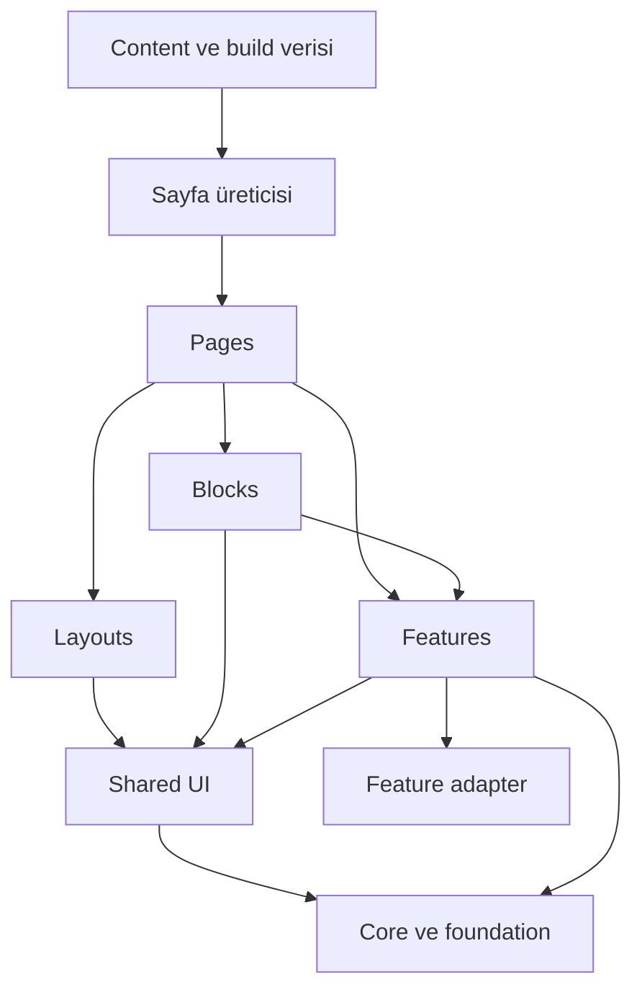
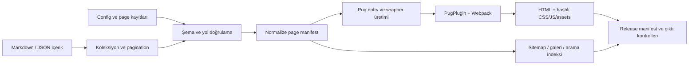

# Çok Amaçlı HTML Tema Framework’ü — Mimari ve Geliştirme Planı

**Tarih:** 3 Ekim 2026  
**Temel:** Bu deponun mevcut Webpack 5 + Pug + SCSS + Bootstrap parçaları + saf JavaScript yapısı  
**Durum:** Mimari öneri ve uygulama yol haritası. Bu çalışma kapsamında uygulama kodu değiştirilmedi; build, test veya performans ölçümü yapılmadı. Aşağıdaki tespitler kaynak kod incelemesine, dış referanslar erişilen birincil kaynaklara dayanır.

**Hızlı erişim:** [Mevcut durum](#2-mevcut-projeden-neyi-koruyoruz-neyi-geliştiriyoruz) · [Mimari](#4-mimari-atomic-design--feature-sahipliği) · [Klasör ağacı](#5-önerilen-hedef-klasör-yapısı) · [Sayfa üretimi](#7-sayfa-kaydı-veri-ve-html-üretimi) · [Sayfalama](#8-gerçek-mpa-routing-ve-sayfalama) · [JavaScript](#9-saf-javascript-component-runtimeı) · [SCSS ve temalar](#10-scss-css-çıktıları-ve-tema-sistemi) · [Build](#11-production-build-minification-ve-asset-hattı) · [Geçiş haritası](#16-mevcut-dosyalar-için-geçiş-haritası) · [Aşamalar](#17-aşamalı-uygulama-planı) · [İlk işler](#18-ilk-uygulanacak-12-iş)

## 1. Hedef ve temel karar

Bu projeyi; aynı çekirdekten kurumsal site, ajans, SaaS, portfolyo, yayın, mağaza ve yönetim paneli sayfaları üretebilen, kaynakları düzenlenebilir bir **çok amaçlı HTML tema framework’üne** büyütelim.

Teslim edilen her adresin kendi HTML belgesi olacak. İçerik Pug ile derleme sırasında üretilecek; tarayıcıya HTML, CSS, JavaScript, font ve görsel dosyaları gidecek. Sayfa geçişlerini tarayıcı yönetecek. JavaScript menü, sekme, dialog, filtre, sepet ve form gibi etkileşimleri geliştirecek. Çıktıyı sunmak için Node.js uygulama sunucusu gerekmeyecek.

Ana mimari kararlar:

| Alan | Karar | Gerekçe |
| --- | --- | --- |
| Render modeli | Derleme sırasında çok sayfalı HTML üretimi | Mevcut yapıyla uyumlu; doğrudan URL, SEO ve statik hosting kolaylığı |
| Template | Pug; inheritance, include ve mixin | Çalışan altyapıyı ve mevcut sayfaları değerlendirmek |
| Stil | SCSS kaynak + CSS custom properties + küçültülmüş CSS çıktısı | Geliştirilebilir kaynaklar, marka ve renk şeması desteği |
| Tarayıcı kodu | ES module kaynaklarıyla saf JavaScript | Küçük, bağımsız ve anlaşılır etkileşimler |
| Build | Webpack ve mevcut `pug-plugin` | İlk aşamada araç değişiminin maliyetini taşımamak |
| Görsel bileşenler | Atomic Design ile sınıflandırılmış ortak UI | Parçaların büyüklüğü ve tekrar kullanımı anlaşılır olsun |
| İşlevler | Kullanıcı yeteneğine göre feature klasörleri | Sepet, filtre, giriş ve fiyatlandırma kendi sorumluluklarını taşısın |
| Sayfalar | Layout, blok ve feature bileşimi | Sayfa dosyası içerik ve yerleşimi anlatsın |
| Tema ürünü | Marka preset’i + blok varyasyonları + çok sayfalı demo paketi | Renk değişiminin ötesinde tutarlı site aileleri üretmek |
| Özelleştirme | Açık token, mixin, event ve adapter sözleşmeleri | Kullanıcının çekirdek dosyalarını değiştirme ihtiyacını azaltmak |

İlk sürüm tek depoda, modüler bir yapı olarak gelişmeli. Her bileşeni ayrı npm paketine bölmek, mikro frontend kurmak veya genel amaçlı bir tarayıcı framework’ü yazmak başlangıç hedefi değil. React/Vue, istemci router’ı ve Pug runtime render katmanı bu planın gereksinimleri arasında yok.

## 2. Mevcut projeden neyi koruyoruz, neyi geliştiriyoruz?

### 2.1. Korunacak temel

- `webpack.config.js` zaten **11 ayrı HTML çıktısı** tanımlıyor: ana sayfa, about, markdown, components, templates, üç auth sayfası, dashboard, commerce ve marketing.
- Sayfalarda Pug, SCSS ve JavaScript dosyalarının yan yana bulunması iyi bir başlangıç.
- `src/layouts/base.pug` ortak belge yapısı, skip link ve ana içerik alanı sağlıyor.
- `src/scss/custom-bootstrap.scss` Bootstrap’ın seçilmiş parçalarını kullanıyor; mevcut grid ve yardımcı sınıflar değerlendirilebilir.
- `src/scss/variables.scss` tasarım tokenları ve koyu tema başlangıcı içeriyor.
- Native dialog, ARIA state, klavye kontrollü sekmeler ve form doğrulama için değerlendirebileceğimiz kod mevcut.
- JS/CSS dosya adlarında content hash zaten kullanılıyor.

### 2.2. Kaynak koddan çıkan somut işler

Satır numaraları inceleme anına aittir. CSS tekrarlarının gerçek byte maliyeti ve tarayıcı davranışları uygulama aşamasında ölçülmelidir.

| Tespit | Kaynak | Uygulama kararı |
| --- | --- | --- |
| Production modunda da `optimization.minimize: false` var | `webpack.config.js:15` | Production JS/CSS küçültmeyi ayrı ve açık biçimde yapılandır |
| Sayfalar tek config içinde elle sıralanıyor | `webpack.config.js:24` | Sayfa kayıtlarından doğrulanmış build manifesti üret |
| Asset public path köke sabit | `webpack.config.js:11` | Kök ve alt dizin yayınını destekleyen URL politikası kur |
| Görsel çıktıları yalnız dosya adına dayanıyor | `webpack.config.js:12` | Tür klasörü, benzersiz adlandırma ve hash kullan |
| Her sayfa SCSS’i ortak `main.scss` dosyasını alıyor | Ör. `src/views/index/index.scss:1`; `src/views/auth/_auth-shared.scss:1` | Ortak CSS’i ayrı kaynak/çıktı olarak sahiplen; sayfadan yeniden derleme |
| Tek layout bütün sayfalara header/footer ekliyor | `src/layouts/base.pug:13` | Belge iskeleti ile site/auth/dashboard/storefront/docs layout’larını ayır |
| Ortak JS, sayfanın `Base()` çağırmasına bağlı | `src/js/layouts/base.js:4` | Ortak runtime yüklemesini layout yönetsin |
| Markdown sayfası yalnız CSS yüklüyor | `src/views/markdown/index.pug:3` | Bu sayfada ortak menü/tema kodunun başlamama riskini layout üzerinden gider |
| UI Library büyük bir demo dosyası olarak büyümüş | `components.pug`: 548; `components.js`: 673; `components.scss`: 1786 satır | Katalog, gerçek ortak bileşenleri kullansın |
| Sekme, toast, parola gösterme kodları tekrarlanıyor | `src/views/index/index.js`, `components/components.js`, `dashboard/dashboard.js`, `auth/*.js` | Ortak controller ve feature API’lerine çıkar |
| Dil ve description sabit | `src/layouts/base.pug:2` ve `:6` | Dil ve SEO bilgisini sayfa verisinden üret |
| Header storage erişimi korumasız, lifecycle yok | `src/js/components/header.js:39` ve `:47` | Güvenli storage, tekrar güvenli mount ve cleanup ekle |
| Mobil menü CSS ile gizleniyor | `src/scss/components/header.scss:55` | JS kapalıyken navigasyon erişilebilir kalsın |
| Marka tokenları sayfalara dağılmış | `components.scss`, `dashboard.scss`, `marketing.scss`, `store.scss` | Primitive → semantic → component token modeli kur |
| Storefront tokenlarında light/dark tamamlanmamış | `src/views/commerce/store.scss:3` | Mağazayı tema kabul matrisine dahil et |
| Fontlar dış CSS `@import` ile geliyor | `src/scss/main.scss:4` | Paketlenebilir, lisansı uygun yerel font akışı kur |
| İki lockfile var; sürüm sözleşmesi eksik | `package-lock.json`, `yarn.lock`, `package.json` | Tek paket yöneticisi/lockfile ve Node sürümü belirle |

Özellikle iki konu ilk pilotta ele alınmalı:

1. **Ortak başlangıç kodu:** `base.pug` ortak script yüklemiyor; markdown sayfasında page script de yok. Kaynak akışına göre o sayfanın header davranışı başlamıyor. Layout sahipliği bu tutarsızlığı gidermeli.
2. **Sepet ve gerçek sayfalama:** `store.js:19` ürünleri görünür DOM kartlarından topluyor. `store.js:146` civarında mevcut ürün haritasında bulunmayan sepet öğeleri kaldırılıyor. Ürünleri ayrı HTML sayfalarına böldüğümüzde diğer sayfanın ürünü sepetten düşmemeli; katalog verisi görünür DOM’dan ayrılmalı.

### 2.3. Mevcut demo işlevlerinin sınırı

| Alan | Şu anki kapsam | Ürünleşme adımı |
| --- | --- | --- |
| Auth | Validation, parola gösterme, pending ve demo mesajları | Ortak form feature’ları ve gerçek servis için adapter sözleşmesi |
| Commerce | Yerel ürünler, filtre/sıralama, localStorage sepet, quick view | Koleksiyon verisi, detay sayfaları, sayfalama, katalogdan bağımsız sepet modeli |
| Checkout/newsletter | Demo geri bildirimi | Ayrı servis adapter’ları; demo ve bağlı modun açık ayrımı |
| Dashboard | Sidebar, sekmeler, tablo filtresi ve dialog | Bağımsız widget’lar; veri adapter’ları; tarih seçimiyle gerçekten eşleşen örnek veri |
| Ana sayfa starter formu | Bilgilendirme mesajı | Daha sonra gerçek CLI scaffold akışına bağlanan rehber |
| Pagination örneği | UI Library’de görsel düğmeler | Gerçek adreslere giden build-time sayfalama |

Statik tema teslimi gerçek kullanıcı hesabı, ödeme, e-posta gönderimi veya sunucu erişim kontrolü sağlamaz. Bu işlevler gerektiğinde feature adapter’ları üzerinden uygulamaya bağlanır. Özellikle statik dashboard dosyalarının gizliliği istemci JavaScript’iyle sağlanamaz.

## 3. ThemeForest referanslarından alınacak ürün yaklaşımı

Referanslar 3 Ekim 2026 tarihinde incelendi. Satış sayısı ve sıralama değişebildiği için burada kesin bir satış sıralaması iddia edilmiyor. ThemeForest HTML kategorisinin “Top selling” bölümünde görülen Canvas ve Porto, hedef teslim modelimiz için doğrudan referans. [ThemeForest HTML temaları](https://themeforest.net/category/site-templates).

| Referans | Doğrulanan ürün yaklaşımı | Bu projeye uyarlama |
| --- | --- | --- |
| [Canvas HTML](https://themeforest.net/item/canvas-the-multipurpose-html5-template/9228123) | Çok sayfalı HTML, sektör demoları, hazır bloklar, SCSS, dark mode ve RTL | Blok kataloğu, sektör paketleri, tema ve yön desteği |
| [Porto HTML](https://themeforest.net/item/porto-responsive-html5-template/4106987) | HTML/CSS/JS kaynakları, Bootstrap tabanı, dokümantasyon, destek ve changelog | Kullanılabilir HTML çıktısı, düzenlenebilir kaynak ve sürüm dokümanlarını birlikte teslim etmek |
| [Avada — WordPress](https://themeforest.net/item/avada-responsive-multipurpose-theme/2833226) | Hazır siteler, içerik blokları, header/footer varyasyonları, global stiller | Ortak sistemden farklı marka ve yerleşimler üretebilmek |
| [BeTheme — WordPress](https://themeforest.net/item/betheme-responsive-multipurpose-wordpress-theme/7758048) | Sektör siteleri, iç sayfa çeşitliliği ve özelleştirme araçları | Her demoyu about/services/contact/blog gibi iç sayfalarıyla tamamlamak |

WordPress referanslarının ürün kapsamını örnek alıyoruz. Bu depoda aynı ürün vaadini Pug bileşimi, tema konfigürasyonu ve statik HTML çıktısıyla karşılayacağız. Referans ürünlerin tasarımlarını, görsellerini veya kodlarını kopyalamak planın parçası değil.

Başarı ölçümüz: **bir geliştirici ortak bileşenleri kullanarak yeni bir marka için tutarlı, hızlı ve çok sayfalı bir siteyi ne kadar kolay çıkarabiliyor?** Demo sayısı tek başına yeterli değil. İç sayfalar, klavye davranışları, mobil düzen, hata durumları, kaynak okunabilirliği ve kurulum rehberi birlikte ürün kalitesini belirler.

## 4. Mimari: Atomic Design + feature sahipliği

Atomic Design, görsel parçaların bileşim seviyesini anlatacak. Feature organizasyonu, bir kullanıcı işinin kod sahipliğini belirleyecek. Bunlar aynı bileşenin iki farklı yerde kopyasını tutmak anlamına gelmemeli.

| Katman | İçerik | Örnek |
| --- | --- | --- |
| Foundation | Token, reset, grid, tipografi, yardımcı stiller | Spacing scale, container, focus ring |
| Atom | Küçük görsel/semantik parça | Button, input, badge, icon |
| Molecule | Birkaç atomdan oluşan ortak desen | Form field, search field, pagination |
| Organism | Domain’den bağımsız büyük UI yapısı | Tabs, dialog, data table, navigation |
| Feature | Kullanıcı yeteneği ve ona ait state | Cart, catalog filter, sign-in, newsletter |
| Block | Sayfaya yerleştirilebilir içerik bölümü | Hero, pricing, testimonials, FAQ, CTA |
| Layout | Belge içindeki ortak çerçeve | Site, auth, dashboard, storefront, docs |
| Page | URL’ye karşılık gelen kompozisyon | About, product detail, blog archive |
| Demo pack | Ortak marka/menü/içerik kullanan sayfa ailesi | Agency, SaaS, editorial, commerce |

`product-card` bir commerce kavramıdır; ilk etapta `features/catalog/ui/` içinde kalabilir. İki bağımsız feature aynı ürün modeline ihtiyaç duymaya başladığında küçük bir `domain/product/` alanı çıkarılabilir. Başlangıçta boş `entities`, `services`, `managers` dizinleri üretmek gerekmiyor.

### Bağımlılık kuralları



- `pages` bir başka sayfanın iç dosyasını import etmez.
- `ui` bir feature veya page import etmez; alt seviyedeki UI ve küçük core yardımcılarını kullanabilir.
- `features` birbirinin özel dosyalarına erişmez. Birden fazla feature’ın koordinasyonu page/block seviyesinde yapılır; ortak domain ihtiyacı kanıtlandığında çıkarılır.
- `layouts` domain iş mantığı taşımaz. Örneğin header içindeki sepet özeti, sayfanın sağlayabildiği slot/block üzerinden eklenir.
- `core` sayfa, tema ve domain isimlerini bilmez.
- `themes` davranış uygulamaz; görünüm tokenları ve seçilebilir preset bilgisi taşır.
- Build verisi ile tarayıcı verisi ayrı tutulur. Bir page data dosyasını import etmek bütün içerik arşivini istemci bundle’ına taşımamalı.
- Her modülün dışarıya açık Pug/SCSS/JS girişleri belgelenir. Dosya içlerine gelişigüzel erişim zamanla lint kurallarıyla sınırlandırılır.

## 5. Önerilen hedef klasör yapısı

Bu ağaç hedef organizasyonu gösterir. Klasörler ihtiyaç duyuldukça açılır; her atom için boş JS, veri veya test dosyası zorunlu değildir.

```text
html-boilerplate/
├── package.json
├── yarn.lock                       # önerilen tek lockfile; ilk fazda kesinleştir
├── webpack.config.js               # ince giriş; config/build modüllerini çağırır
├── config/
│   ├── site.config.cjs             # siteUrl, basePath, varsayılan dil, marka
│   ├── build.config.cjs            # development/production ve paket profilleri
│   ├── browserslist               # hedef tarayıcı politikası
│   └── schemas/                   # page, theme, content şemaları
├── build/
│   ├── webpack/                   # loader, optimization, asset ayarları
│   ├── pages/                     # kayıt toplama, doğrulama, entry adaptörü
│   ├── collections/               # blog/katalog/detail/pagination üretimi
│   ├── helpers/                   # route, canonical, navigation, asset yardımcıları
│   └── generators/                # sitemap, search-index, gallery, release manifest
├── scripts/
│   ├── create-page.mjs
│   ├── create-component.mjs
│   ├── create-demo.mjs
│   └── package-release.mjs
├── src/
│   ├── core/
│   │   ├── runtime/               # mount, kayıt, cleanup, shell başlangıcı
│   │   ├── dom/                   # focus, event, safe text gibi küçük yardımcılar
│   │   └── storage/               # sürümlü ve hataya dayanıklı persistence
│   ├── styles/
│   │   ├── tokens/                # primitive ve semantic varsayılanlar
│   │   ├── tools/                 # CSS üretmeyen Sass function/mixin/modülleri
│   │   ├── foundation/            # reset, type, containers, grid
│   │   ├── utilities/             # sınırlandırılmış yardımcı sınıflar
│   │   ├── vendor/                # Bootstrap compatibility ve seçili imports
│   │   └── core.scss              # bir defa bağlanan ortak CSS kaynağı
│   ├── ui/
│   │   ├── atoms/
│   │   │   └── button/
│   │   │       ├── button.pug
│   │   │       ├── _button.scss
│   │   │       └── button.docs.md
│   │   ├── molecules/
│   │   │   ├── form-field/
│   │   │   ├── search-field/
│   │   │   └── pagination/
│   │   └── organisms/
│   │       ├── tabs/
│   │       │   ├── tabs.pug
│   │       │   ├── _tabs.scss
│   │       │   ├── tabs.js
│   │       │   └── tabs.docs.md
│   │       ├── dialog/
│   │       └── data-table/
│   ├── features/
│   │   ├── auth/
│   │   │   ├── ui/                # login/register/reset form şablonları
│   │   │   ├── model/             # form state ve validation kuralları
│   │   │   ├── adapters/          # demo ve gerçek servis arayüzü
│   │   │   ├── index.js           # dışarıya açık JS API
│   │   │   └── _auth.scss
│   │   ├── catalog/               # ürün kartı, filtre/sort; katalog repository API
│   │   ├── cart/                  # sepet modeli, drawer, storage
│   │   ├── newsletter/
│   │   └── pricing/
│   ├── blocks/
│   │   ├── hero-split/
│   │   ├── hero-editorial/
│   │   ├── pricing-grid/
│   │   ├── testimonial-grid/
│   │   ├── faq/
│   │   └── site-header/
│   ├── layouts/
│   │   ├── document.pug           # html/head/body, metadata, ortak asset slotları
│   │   ├── site/                  # layout.pug, shell.js, shell.scss
│   │   ├── auth/
│   │   ├── dashboard/
│   │   ├── storefront/
│   │   └── docs/
│   ├── pages/
│   │   ├── home/
│   │   │   ├── page.json          # tekil kayıt: id, route, source, metadata
│   │   │   ├── page.pug
│   │   │   ├── page.scss          # sadece bu kompozisyonun stilleri
│   │   │   ├── page.js            # opsiyonel sayfa davranışı
│   │   │   └── page.data.cjs       # opsiyonel build verisi
│   │   ├── auth/{login,register,forgot-password}/
│   │   ├── commerce/{listing,product,cart}/
│   │   ├── blog/{listing,article,category}/
│   │   ├── dashboard/
│   │   ├── components/
│   │   └── templates/
│   ├── themes/
│   │   ├── default/               # theme.json + theme.scss
│   │   ├── corporate/
│   │   ├── editorial/
│   │   └── commerce/
│   ├── demos/
│   │   ├── agency/demo.json        # tema, sayfa id’leri, menü ve fixture seçimi
│   │   ├── saas/demo.json
│   │   └── editorial/demo.json
│   ├── content/
│   │   ├── posts/                 # Markdown ve tanımlı metadata
│   │   ├── products/              # katalog kayıtları
│   │   └── locales/               # ortak arayüz metinleri
│   ├── data/                      # site menüsü, fixtures, ortak içerik
│   └── assets/{images,icons,fonts}/
├── public/                         # dönüşmeden kopyalanacak dosyalar
├── docs/                           # mimari, kullanım, migration, release rehberi
├── qa/                             # ileride: anlamlı kabul kontrol ve fixture’ları
├── .generated/                     # build türevi; git dışında
├── dist/                           # yayınlanacak çıktı; elle düzenlenmez
└── release/                        # teslim paketleri; git dışında
```

`views → pages`, `scss → styles`, `js → core/ui/features` geçişi tek seferde yapılmayacak. Eski alias’lar geçici köprü sağlayacak. Build sırasında eski entry’ler ile yeni page kayıtları birleştirilip çakışma kontrolünden geçirilecek; taşınan sayfanın eski kaydı aynı adımda kaldırılacak.

## 6. Bileşen sözleşmesi ve tekrar kullanım

Bir bileşen “aynı HTML’i başka yere kopyalayabiliyorum” seviyesinden çıkıp açık bir kullanım arayüzüne sahip olmalı. Pug mixin’leri parametreli tekrar kullanım ve içerik block’ları sağlar; include’lar statik parçaları ve mixin tanımlarını derlemede birleştirir. [Pug mixins](https://pugjs.org/language/mixins.html), [Pug includes](https://pugjs.org/language/includes.html).

Her gerçek bileşenin dokümanında şu bilgiler yer almalı:

| Sözleşme | İçerik |
| --- | --- |
| Amaç | Hangi kullanıcı ihtiyacını karşılıyor? |
| Template API | Gerekli props, varsayılanlar, slot/block’lar |
| Görünüm | Variant, size, density, public CSS variables |
| Durum | Default, hover, focus, disabled, busy, error, empty |
| Semantik | Doğru HTML elemanı, label ve ARIA ilişkileri |
| Davranış | Klavye, focus, Escape, dışarı tıklama kuralları |
| JS olmadan | Görünen içerik ve mevcut temel işlev |
| Çoklu kullanım | Aynı sayfada iki instance ve benzersiz ID politikası |
| Lifecycle | `mount(root, options)` ve gerektiğinde `destroy()` |
| Entegrasyon | Event isimleri, payload ve callback’ler |
| Asset sahipliği | Hangi CSS/JS girişinin bileşeni içerdiği |

Örnek Pug API’si; aşağıdaki kod bir tasarım örneğidir, bu görevde repoya uygulanmamıştır:

```pug
mixin button(options = {})
  - const { label, variant = 'primary', type = 'button', disabled = false } = options
  button.ui-button(class=`ui-button--${variant}` type=type disabled=disabled)&attributes(attributes)
    if block
      block
    else
      = label

+button({ label: 'Kaydet', variant: 'primary', type: 'submit' })
```

Variant değerleri build şemasında sınırlandırılır. Navigation için ayrı link bileşeni kullanılır; bir action button’a URL ekleyerek semantiği belirsizleştirmeyiz. Kullanıcı/CMS metni escaped output ile yazılır. Güvenilir zengin içerik için ayrı, belgelenmiş bir sanitization sınırı gerekir.

Görünüm sınıfları `ui-*`, `block-*`, `feature-*` gibi sahipliği okunur adlar kullanabilir. Mevcut `.button`, `.form-*`, `.status-badge` API’leri geçiş boyunca alias ile desteklenir. JavaScript görünüm sınıfına bağlanmaz; `data-component`, `data-action` ve ilişkili ARIA attribute’larını kullanır.

Yeni soyutlama için pratik kural: iki bağımsız kullanımda ortak ihtiyaç ortaya çıktığında API’yi çıkar; üçüncü kullanımda da anlamını koruduğunu değerlendir. Her `<div>` veya yalnız tek sayfada anlamlı dekorasyon ayrı component olmak zorunda değil.

## 7. Sayfa kaydı, veri ve HTML üretimi

### 7.1. Tekil kayıt ve türetilmiş manifest

Her somut sayfa kendi `page.json` kaydına sahip olsun. Koleksiyon sayfaları blog/katalog üreticilerinden aynı normalize edilmiş kayıt formatında gelsin. Bunlar birleşerek `.generated/pages-manifest.json` oluştursun.

Önerilen kayıt örneği:

```json
{
  "id": "agency.about.tr",
  "route": "/demos/agency/about/",
  "source": "src/pages/agency/about/page.pug",
  "layout": "site",
  "theme": "corporate",
  "locale": "tr",
  "direction": "ltr",
  "title": "Hakkımızda — Atlas Ajans",
  "description": "Atlas Ajans ekibi, yaklaşımı ve uzmanlık alanları.",
  "data": "src/pages/agency/about/page.data.cjs",
  "styles": ["src/pages/agency/about/page.scss"],
  "script": "src/pages/agency/about/page.js",
  "navigation": { "group": "agency-main", "label": "Hakkımızda", "order": 20 },
  "gallery": { "category": "agency", "preview": true },
  "robots": "index,follow"
}
```

Bu şema önerisidir; `pug-plugin` seçenekleriyle birebir aynı kabul edilmemelidir. `build/pages/` adaptörü bunu mevcut plugin’in `import`, `filename`, `data` entry formatına çevirir.

- `route`, sitenin basePath hariç kanonik yolu; `output`, bu yoldan üretilen göreli dosya adıdır. Örnekte `demos/agency/about/index.html` olur. İkisini elle yönetmeyerek uyuşmazlığı önleriz.
- `layout`, build adaptörünün kontrollü Pug wrapper seçmesine dönüşür. JSON alanı tek başına Pug inheritance’ını değiştirmez; seçilen layout’u `extends` eden wrapper `.generated/` altında oluşturulur.
- Yeni `page.pug`, wrapper’ın içerik alanına dahil ettiği kompozisyon parçasıdır; tekrar `extends` yazmaz. Ek head/script alanları metadata ve tanımlı slot mekanizmasından gelir. Eski `extends` kullanan sayfalar geçişte legacy adaptörle doğrudan entry kalır. Böylece layout seçiminin iki bağımsız kaynağı oluşmaz.
- `styles`, `script`, tema ve layout asset’ları wrapper’ın slotlarına eklenir. Build graph, Pug içindeki kaynak asset referanslarını izler.
- Kayıtlardaki yollar repo köküne göredir. `.generated/` wrapper yazılırken bunlar tanımlı `@pages`, `@layouts`, `@images` gibi alias’lara veya wrapper’a göre doğru göreli yola çevrilir. Ham `src/...` yolu wrapper içine kopyalanmaz; `.generated/src/...` altında çözülme hatası önlenir. İçerik verisindeki görsel yolları da aynı kurala tabi olur.
- Feature listesi ayrıca elle tutulmaz; sayfanın JS girişindeki açık import’lar davranış bağımlılıklarının kaynağıdır. CSS bağımlılıkları SCSS girişleri tarafından sahiplenilir. Yeni scaffold her iki dosyayı birlikte oluşturabilir; global DOM taramasıyla bütün kütüphane yüklenmez.
- Navigation ve galeri kayıtları sayfa metadata’sından türetilir; dış linkler ve grup başlıkları site verisinde kalabilir.
- Koleksiyon route’ları, üretici tarafından aynı şemaya eklenir. Böylece sitemap, asset doğrulama ve release raporu bütün sayfalara aynı kuralla uygulanır.
- Pug include/extends yolları build sırasında sabit ve izlenebilir olmalı. İlk sürümde sınırsız JSON block renderer veya görsel sayfa editörü yazılmaz.

### 7.2. Build akışı



### 7.3. Derlemenin reddedeceği durumlar

- Aynı page ID, route veya output; büyük/küçük harf farklılığından doğan çakışmalar.
- Kaynak klasörünün dışına çıkan yol, `..` içeren uygunsuz output veya mutlak disk yolu.
- Olmayan source/layout/theme/data referansı; eksik title, locale veya hatalı metadata.
- Aynı slug’a dönüşen iki içerik; belirsiz sıralama; geçersiz tarih; olmayan içerik ilişkisi.
- Seçilen demo paketinde bulunmayan iç hedefe giden menü linki.

Development watch; Pug/SCSS/JS yanında page kayıtları, JSON içerik ve Markdown değişikliklerini de izlemeli. İçerik silindiğinde artık üretilmemesi gereken HTML dosyaları manifest farkına göre temizlenmeli; eski build’den yetim sayfa kalmamalı. Asset ve kod kaynakları plugin graph’ına açık yollarla verilerek izlenebilir tutulmalı.

## 8. Gerçek MPA routing ve sayfalama

“Sayfalama” bu projede hem sayfa organizasyonunu hem koleksiyonların birden fazla HTML belgeye bölünmesini kapsamalı.

### 8.1. URL ve dosya sözleşmesi

| URL | Üretilen dosya | Amaç |
| --- | --- | --- |
| `/` | `dist/index.html` | Ana sayfa |
| `/about/` | `dist/about/index.html` | Sabit içerik |
| `/blog/` | `dist/blog/index.html` | İlk arşiv sayfası |
| `/blog/page/2/` | `dist/blog/page/2/index.html` | İkinci arşiv sayfası |
| `/blog/ornek-yazi/` | `dist/blog/ornek-yazi/index.html` | İçerik detayı |
| `/blog/category/design/` | `dist/blog/category/design/index.html` | Kategori arşivi |
| `/commerce/` | `dist/commerce/index.html` | Ürün listesi |
| `/commerce/page/2/` | `dist/commerce/page/2/index.html` | Katalog sayfası |
| `/commerce/product/desk-lamp/` | `dist/commerce/product/desk-lamp/index.html` | Ürün detayı |
| `/404.html` | `dist/404.html` | Hosting’e tanıtılacak hata belgesi |

Standart çıktı directory-index modelini kullanır. `/about` → `/about/` yönlendirmesi ve 404 durum kodu hosting adaptöründe tanımlanır. Bilinmeyen adresler ana sayfaya rewrite edilmez. URL alanına bir iç sayfa adresi yapıştırmak ve o sayfayı yenilemek doğrudan çalışmalıdır.

Üç farklı kavram ayrı konfigürasyon olmalı:

- `siteUrl`: canonical/OG/sitemap için yayın origin’i; ör. `https://example.com`.
- `basePath`: site kurulum yolu; ör. `/` veya `/preview/theme/`.
- `assetBase`: asset URL’lerinin kökü; normalde basePath altı, isteğe göre ayrı CDN adresi.

`route(pageId, params)` yardımcısı site içi linkleri üretir. Webpack `publicPath` yalnız asset adresini çözmezse linklerin ayrıca düzeltilmesi gerektiği unutulmamalı; template içindeki hardcoded `/...` yolları da taşınır. Alt dizin senaryosunda çift prefix ve `//` oluşmaması doğrulanır. Canonical oluştururken origin + basePath + route kontrollü birleştirilir.

İlk hedef HTTP(S) üzerinden statik sunumdur. `file://` ile çift tıklayıp çalıştırma; root-relative link, fetch ve module kısıtları nedeniyle ayrıca tasarlanması gereken bir çıktı profilidir. İlk sürüm için basit bir yerel preview komutu belgelenir.

### 8.2. Koleksiyon üreticisi

Blog/katalog üreticisinin girdisi:

```js
// Önerilen konfigürasyon; mevcut bir API değildir.
const collection = {
  id: 'blog',
  source: 'src/content/posts',
  sort: ['publishedAt:desc', 'id:asc'],
  pageSize: 9,
  firstRoute: '/blog/',
  nextRoute: '/blog/page/:page/',
  detailRoute: '/blog/:slug/',
  excludeDrafts: true,
};
```

Üretim adımları:

1. İçerikleri oku, metadata’yı doğrula, draft/yayın tarihi filtresini uygula.
2. Eşit tarihleri sabit ID ile çözerek deterministik sırala.
3. Kayıtları `pageSize` ile dilimle; her dilim için bir HTML entry oluştur.
4. `currentPage`, `totalPages`, `totalItems`, `previousUrl`, `nextUrl` ve görünür sayfa linklerini template’e ver.
5. İlk sayfa için `/page/1/` kopyası üretme; kanonik adres `/blog/` olsun.
6. Boş koleksiyonda tek boş durum sayfası üret; boş son sayfa üretme.
7. Her detay ve kategori sayfasını benzersiz route’la kaydet.
8. Silinen/yayın dışına alınan kaydın eski çıktısını temizle; gerekiyorsa yönlendirme kaydını release verisinde tut.

Pagination markup’ı `nav` ve gerçek `<a href>` elemanlarından oluşur. Aktif sayfada `aria-current="page"`, anlaşılır bağlantı adları ve geçerli önceki/sonraki yollar bulunur. Olmayan yön için tıklanabilir `href="#"` üretilmez. Uç durumlar: 0, 1, tam sayfa büyüklüğü ve büyüklük+1 kayıt; ilk/son sayfa; çok uzun sayfa aralığı.

### 8.3. Filtre, arama ve pagination birbirinden nasıl ayrılacak?

| İhtiyaç | Yaklaşım |
| --- | --- |
| SEO amaçlı blog/katalog arşivi | Derleme sırasında gerçek HTML sayfaları |
| Küçük demo tablosunu sayfalama | Yalnız o tablo içinde çalışan JavaScript feature |
| Sadece ekrandaki sonuçları filtreleme | Kapsamı açıkça görünen yerel filtre; toplam katalog araması gibi sunulmaz |
| Küçük kataloğun tamamında arama | Build’de üretilen sınırlı arama indeksi; sonuçlar gerçek detay linklerine gider |
| Büyük katalog veya canlı envanter | Search/catalog adapter’ı ile dış servis |

Seçilebilir kategori arşivleri önceden üretilebilir; bütün fiyat, renk, sıralama ve arama kombinasyonlarını HTML olarak çoğaltmayız. Query string filtre durumunu taşıyabilir, fakat `/commerce/?color=red` adresi kendi başına sunucuda filtrelenmiş bir HTML üretmez. Bu modun çalışması tam indeks veya servis gerektirir; JavaScript kapalıyken temel katalog ve kategori linkleri kullanılabilir olmalıdır.

URL query state kullanan enhancement, yüklemede ve `popstate` sırasında durumunu geri kurar. Bu, yerel filtre state’idir; site çapında client router kurulmaz.

### 8.4. Sepet modeli için zorunlu düzeltme

- Sepet state’i `productId`, `variantId` ve miktar üzerinden tanımlanır; görünür kart listesi üzerinden doğrulanmaz.
- Demo katalog repository’si bütün demo ürünlerini veya ID ile çözülebilen shard’ları bilir. Sepette görünen ürün sayfa dışında diye silinmez.
- Page composition, repository arayüzünü cart ve quick-view controller’larına parametre olarak verir; cart başka feature’ın iç dosyasını import etmez. Paylaşılan ürün modeli büyürse `domain/product/` alanına çıkarılır.
- Kalıcı state için sürümlü anahtar kullanılır: ör. `theme:commerce-demo:cart:v1`.
- Site/demoların sepetlerinin birbirine karışması önlenir. Bozuk veya eski kayıt kontrollü biçimde dönüştürülür ya da güvenli varsayılana alınır.
- Gerçek sistemde fiyat, stok, indirim ve yetki sunucuda doğrulanır. Tarayıcıda gösterilen fiyat ödeme otoritesi olmaz.
- Bir sayfada ürün ekle → başka katalog sayfasına git → sepeti aç → yenile akışı ilk commerce kabul senaryosudur.

## 9. Saf JavaScript component runtime’ı

### 9.1. Küçük ve açık başlangıç modeli

Layout kendi ortak shell script’ini yükler. Sayfanın JS girişi yalnız ihtiyacı olan feature/controller’ları import eder. Statik sayfa için boş `page.js` zorunlu değildir. UI örnekleri de üretimle aynı modülleri kullanır.

```js
// Önerilen page entry örneği.
import { mountTabs } from '@ui/organisms/tabs/tabs.js';
import { mountPricing } from '@features/pricing/index.js';

document.querySelectorAll('[data-component="tabs"]').forEach((root) => {
  mountTabs(root);
});

document.querySelectorAll('[data-feature="pricing"]').forEach((root) => {
  mountPricing(root);
});
```

Ortak registry gerekirse yardımcı olarak eklenir; tüm component kataloğunu import eden merkezî bir dosya haline gelmez. Ağır ve nadir bir widget için açık bir `import()` kullanılabilir. Dynamic import yolları kontrol edilen sabit eşlemeden gelir; DOM’dan alınan serbest dosya adları yürütülmez.

### 9.2. Controller sözleşmesi

| Başlık | Karar |
| --- | --- |
| Başlatma | `mount(root, options)` instance döndürür |
| Kapsam | Selector’lar component root’u içinde çalışır |
| Tekrar çağrı | WeakMap benzeri kayıtla aynı root ikinci kez bağlanmaz |
| Cleanup | `destroy()` event, observer, timer ve kayıtları temizler |
| Event | Belgelenmiş `CustomEvent`; ör. `cart:change`, `dialog:close` |
| State | Küçük instance state’i; gerekli veri dışında global store yok |
| ID | Pug’ya açık `idPrefix` verilir; çoklu instance çakışmaz |
| Hata | Bir widget başarısız olsa da diğer bağımsız widget’lar çalışır |
| Async | Pending/error/empty durumları ve iptal edilebilir istekler |

`AbortController` listener temizliği için değerlendirilebilir; timer’lar ayrıca `clearTimeout/clearInterval`, observer’lar `disconnect` ile kapatılır. Async mount kullanılırsa başlatma sürerken ikinci çağrının da tek instance’a yönelmesi gerekir. Controller’ı yok etmek tekrar mount edilebilmesini engellememeli.

Bu lifecycle; aynı bileşenin bir sayfada çoğaltılması, component playground ve dinamik olarak eklenen küçük parçalar için yararlıdır. Normal sayfa navigasyonunda browser belgeyi yeniler. Her sayfa geçişini yakalayıp HTML fetch eden bir katman eklenmez.

### 9.3. Temel tarayıcı davranışı

- İçerik, linkler, başlıklar ve form etiketleri derlenmiş HTML’de hazır olur.
- JS yüklenmeden menü linkleri erişilebilirdir; daraltma davranışı ancak ilgili controller başarıyla başladığında etkinleşir.
- Sekmelerin panelleri temel HTML’de okunabilir; enhancement başlayınca seçili panel modeli uygulanır.
- Native `<details>` uygun accordion senaryolarında kullanılabilir.
- Modal eyleminin temel içeriğe ulaşmak için sayfa linki gibi makul fallback’i varsa sunulur; zorunlu JS davranışı sessizce bozuk bırakılmaz.
- Gerçek endpoint bağlanan formun `action/method` davranışı korunabilir. Demo formu gerçek işlem tamamlandı izlenimi yaratmaz.
- Auth tokenları, gizli anahtarlar ve özel veriler statik HTML veya localStorage sepetine eklenmez.
- CMS/API verisi DOM’a yazılırken `textContent` veya güvenli template cloning kullanılır; HTML interpolation yalnız doğrulanmış/sanitize edilmiş içerik için ayrılır.

Progressive enhancement için temel yaklaşım, içeriği ve ana işlevi önce sunup desteklenen etkileşimi üzerine eklemektir. [MDN progressive enhancement](https://developer.mozilla.org/en-US/docs/Glossary/Progressive_Enhancement).

## 10. SCSS, CSS çıktıları ve tema sistemi

### 10.1. CSS sahipliği

Hedef yükleme sırası:

```text
core.css → theme.css → layout.css → page.css → custom.css (varsa)
```

| Çıktı | Sahip olduğu stiller |
| --- | --- |
| `core` | Reset, seçili Bootstrap grid/utility, temel type, semantic token varsayılanları, çok küçük ortak primitive’ler |
| `theme` | Seçilen marka ve light/dark token değerleri; font tanımları |
| `layout` | Header/sidebar/footer ve o layout’un ortak yerleşimi |
| `page` | Kullanılan ek UI/feature/block stilleri ve sayfa kompozisyonu |
| `custom` | Tema kullanıcısının belgelenmiş override alanı |

Bir partial’ın sahibi nettir. `page.scss`, `core.scss` veya tüm tema kataloğunu import etmez. İki page aynı component’i kullanıyorsa o component CSS’inin iki ayrı page çıktısında bulunması ilk aşamada kabul edilebilir; aynı belgede iki kez bulunması önlenir. Gerçek tekrar maliyeti ölçülünce sık kullanılan component’ler ortak katmana taşınır. Her atom için ayrı HTTP isteği üreten yüzlerce CSS dosyası çıkarılmaz.

Örneğin button CSS’inin sahibi core ise layout ve feature stilleri onu tekrar emit eden bir import yapmaz; yalnız CSS üretmeyen Sass araçlarını veya public tokenları kullanır. Ortak stiller için küçük bir sahiplik listesi tutulur ve build çıktısı bu listeyle kontrol edilir. Böylece layout/page girişlerini ayrı derlemek sessiz CSS tekrarına dönüşmez.

Sass `@use` bir modülü bir derleme içinde bir kez dahil eder; farklı sayfa girişlerindeki tekrarları kendiliğinden çözmez. Ortak çıktı kararı açık asset sahipliği gerektirir. [Sass `@use`](https://sass-lang.com/documentation/at-rules/use/).

### 10.2. Token katmanları

```css
/* Önerilen public token modeli */
:root {
  --palette-brand-600: #4f46e5;
  --space-4: 1rem;
  --color-action: var(--palette-brand-600);
  --color-surface: #fff;
  --color-text: #0f172a;
  --button-bg: var(--color-action);
}

[data-theme="corporate"] {
  --palette-brand-600: #175cd3;
}

[data-color-scheme="dark"] {
  --color-surface: #111827;
  --color-text: #f8fafc;
}
```

Üç katman: ham palette/scale → anlamlı token → yalnız gerektiğinde component token. Feature’lar mümkün olduğunca `--color-surface`, `--color-danger`, `--space-*`, `--radius-*` kullanır. Her feature’ın kendi bağımsız renk sistemini kurması önlenir.

Tema eksenleri:

- **Marka:** default, corporate, editorial, commerce.
- **Renk şeması:** light, dark, system.
- **Yoğunluk:** comfortable, compact; özellikle tablo ve dashboard.
- **Yön:** `dir="ltr|rtl"`; margin/padding-inline gibi logical properties.
- **Kompozisyon:** header varyantı, container genişliği, hero düzeni ve blok seçimleri.

Renk şeması/marka durumu kök `html` elemanında tutulur; dialog/drawer gibi yüzeyler de aynı tokenları miras alır. Tema tercihinde açık kullanıcı seçimi → sistem tercihi → site varsayılanı uygulanır. Storage okunamadığında sayfa çalışmaya devam eder.

Tema flash’ını azaltmak için ilk boyamadan önce yalnız renk şemasını belirleyen küçük, sabit ve güvenli bir başlangıç script’i düşünülebilir. Inline kullanılacaksa yayın CSP politikasına uygun hash eklenir. Ana etkileşim bundle’ı defer ile yüklenir. JS kapalı durumda CSS medya sorgusu ve varsayılan tema okunabilir bir görünüm sağlar.

### 10.3. Sass ve Bootstrap geçişi

- Projeye ait Sass modülleri kademeli olarak `@use/@forward` yapısına geçirilir.
- Build-time Sass değişken/function’ları ile runtime CSS custom properties ayrılır. `styles/tools/` CSS üretmez; token CSS’i yalnız ilgili entry’den çıkar.
- Bootstrap’ın mevcut import/override sırası tek `styles/vendor/` compatibility alanında kalır; mekanik bir arama-değiştirme yapılmaz.
- Bootstrap JS paketi varsayılan bundle’a eklenmez; mevcut saf JS davranışlar devam eder.
- Yeni utility seti eklemeden mevcut Bootstrap utility’lerinin kullanım ve maliyeti incelenir.

Sass’ın resmi dokümanı `@import` kullanımının Dart Sass 1.80.0’dan itibaren deprecated olduğunu belirtiyor. İncelenen `yarn.lock` Sass 1.67.0’a çözümleniyor; bu rapor mevcut build’de deprecation uyarısı görüldüğünü iddia etmiyor. Geçiş, gelecekteki güncellemeler için planlanıyor. [Sass `@import` değişikliği](https://sass-lang.com/documentation/breaking-changes/import/).

### 10.4. Cascade ve responsive kuralları

- BEM benzeri, düşük specificity kullanan sınıflar; stil seçicilerinde ID bağımlılığı yok.
- Component stilleri başka sayfanın kapsayıcı sınıfına dayanmaz.
- Mobile-first kurallar, ortak breakpoint tokenları, akışkan type/spacing ve içerik tabanlı kırılmalar kullanılır.
- Uygun bloklarda container query, hedef tarayıcı ve fallback değerlendirilerek eklenir.
- `prefers-reduced-motion` ortak politika olarak tanımlanır; gerekli component istisnaları açık tutulur.
- `@layer` ileriki bir iyileştirmedir. Kullanılırsa vendor, base, component ve override sırası bütün kaynaklarda tutarlı kurulmalıdır; katman dışı Bootstrap CSS’i bırakıp override davranışını varsaymayız.
- PurgeCSS başlangıç şartı değildir. Öncelik kullanılmayan bileşeni hiç import etmemektir. Daha sonra uygulanırsa runtime state/variant sınıfları ve içerik kaynakları için safelist ve görsel regresyon kontrolü gerekir.

## 11. Production build, minification ve asset hattı

### 11.1. Mevcut build’in üzerine yapılacaklar

1. Webpack config’i mode’a göre üreten küçük bir factory’ye dönüştür.
2. Production’da mevcut `minimize: false` override’ını kaldır; JS minimizer’ın çalışmasını sağla.
3. CSS için açık minifier seç ve mevcut Sass/CSS loader hattıyla bağla. Eklenen minimizer Webpack’in varsayılan JS minimizer’ını yanlışlıkla devre dışı bırakmasın.
4. HTML minification’ını plugin sürümünde desteklenen ayarla yönet; `pre/code`, attribute ve erişilebilirlik metinlerinin korunmasını kontrol et.
5. Development’da okunabilir çıktı ve source map; production tesliminde map politikasını açıkça belirle.
6. Build raporuna sayfa bazlı asset listesi, ham/gzip boyutları ve tekrar eden ortak içerik bilgisini ekle.

`pug-plugin` zaten template içindeki kaynak asset’ları çözüp CSS/JS çıktısına bağlar. Bu iş için ikinci bir CSS extraction sistemi eklenmez. İleri optimizasyon ayarları kurulu sürümün API’sine göre doğrulanır. [Pug Plugin resmi deposu](https://github.com/webdiscus/pug-plugin). CSS küçültme için Webpack’in belgelenmiş eklentisi değerlendirilebilir. [CSS Minimizer Webpack Plugin](https://webpack.js.org/plugins/css-minimizer-webpack-plugin/).

### 11.2. Çıktı örneği

```text
dist/
├── index.html
├── about/index.html
├── blog/index.html
├── blog/page/2/index.html
├── blog/ornek-yazi/index.html
├── commerce/product/desk-lamp/index.html
├── 404.html
├── sitemap.xml
├── robots.txt
├── assets/
│   ├── css/core.a31e9c02.min.css
│   ├── css/themes/corporate.246ad183.min.css
│   ├── css/layouts/site.a62048cb.min.css
│   ├── css/pages/agency-about.041d2fab.min.css
│   ├── js/shell.9c232afd.min.js
│   ├── js/pages/commerce-listing.823aa831.min.js
│   ├── js/chunks/optional-gallery.0f12aa33.min.js
│   ├── images/agency-hero.5bd13a02.webp
│   ├── fonts/brand-sans-latin.084c41de.woff2
│   └── data/search-tr.3f072134.json
└── release-manifest.json
```

Adlar örnektir. Bütün sayfalarda `page.scss` adı kullanılsa da çıktı tek `page.css` üstüne yazılmaz; build adaptörü normalize page ID’sinden benzersiz entry kimliği üretir. Hash tek başına insan tarafından anlaşılır sahipliği sağlamadığı için klasör/entry adı da korunur.

`.min.css` dosya adı küçültme yapıldığı anlamına gelmez; kabul ölçütü gerçek çıktıdır. SCSS geliştirilebilir kaynak olarak teslim edilir, tarayıcı SCSS yüklemez.

### 11.3. Cache, chunk ve sıkıştırma

- İçerik hash’li asset’lar uzun cache süresine uygundur; HTML daha kısa cache veya revalidation ile sunulur.
- Ortak shell ve uygun shared chunk’lar sayfalar arasında cache avantajı sağlayabilir. `splitChunks/runtimeChunk` ayarları plugin’in ürettiği HTML’de bütün gerekli script’lerin doğru sırada bulunmasıyla birlikte doğrulanır.
- Paket içindeki her HTML bağımsız açılabilmeli; shared chunk’ı yalnız önceki sayfanın yüklediği varsayılmaz.
- İlk pilotta karmaşık chunk optimizasyonundan önce doğru ortak CSS/JS sahipliği kurulur.
- Gzip/Brotli HTTP sıkıştırması minification’dan ayrı bir aşamadır. Hosting destekliyorsa etkinleştirilir; `.gz/.br` ön üretimi opsiyoneldir ve doğru sunucu header’larıyla anlam kazanır.
- Lisans bildirimleri release paketinde korunur; minifier yorum politikası buna göre ayarlanır.

### 11.4. Görsel ve font hattı

- Aynı `hero.jpg` ismini kullanan iki demo çakışmamalı; hash ve kaynak bağlamı korunmalı.
- Fotoğraflar için uygun AVIF/WebP/fallback ve responsive `srcset/sizes` üretimi planlanır. İlk etapta seçili demo görselleriyle sınırlı tutulabilir.
- Görsellere boyut/aspect-ratio ayrılır; ekran altı görseller lazy yüklenir. İlk görünümün önemli hero/LCP görseli koşulsuz lazy yapılmaz.
- SVG ikonlar mevcut sistemle uyumlu bir sprite veya kontrollü inline kaynak üzerinden kullanılır; her ikon için büyük bir paket import edilmez.
- Yerel WOFF2, gerekli ağırlıklar, lisansı uygun subset ve `font-display` politikası kullanılır. TR paketinde Türkçe karakter kapsamı korunur.
- Yalnız ilk görünümde gerçekten kullanılan font/görsel preload edilir.
- `public/` kopyalama adımı hashing yapmayan dosyalar için ayrılır; font/görsel dönüşümü gereken kaynaklar asset graph’ından geçer.

## 12. Layout, blok ve demo ürün kataloğu

### 12.1. Layout ailesi

| Layout | Sorumluluk |
| --- | --- |
| Document | Metadata, language/direction, head/body slotları, temel asset sırası |
| Site | Header, footer, ana içerik, isteğe bağlı üst bilgi çubuğu |
| Auth | Odaklı form alanı, split visual veya sade merkezî düzen |
| Dashboard | Sidebar, topbar, içerik/grid ve mobil navigasyon |
| Storefront | Mağaza navigasyonu ve feature eklenebilir alanlar |
| Docs | İçerik navigasyonu, TOC, code örnekleri |
| Minimal | 404, maintenance, coming soon gibi sade belgeler |

Layout genişleyen bir dev template’e dönüşmemeli. `showSidebar`, `hideHeader`, `isCheckout`, `isAgency` gibi çok sayıda boolean yerine amaca uygun layout ve slot’lar seçilmeli.

### 12.2. Öncelikli bileşen ve blok seti

| Öncelik | Kapsam | İlk hedef |
| --- | --- | --- |
| P0 | Button/link, input/field, select, checkbox/radio, badge, alert, card | Mevcut tekrarları ortak sözleşmeye taşımak |
| P0 | Tabs, dialog, toast, disclosure, pagination | Klavye/focus/çoklu instance davranışını standartlaştırmak |
| P1 | Breadcrumb, search, empty state, table, skeleton, progress | İç sayfaları ve veri durumlarını tamamlamak |
| P1 | Hero, feature grid, logo strip, stats, testimonial, pricing, FAQ, CTA | Marketing ve kurumsal demoları aynı bloklarla kurmak |
| P1 | Product card, filter, cart drawer, quick view | Commerce feature ailesini tamamlamak |
| P2 | Gallery/lightbox, carousel, timeline, comparison, advanced table | Gerçek ihtiyaç ve performans bütçesine göre eklemek |

Varyantlar sınırlı ve anlamlı olmalı: hero için split/centered/editorial; header için standard/transparent/commerce; kart için media/text/product. Her bileşene onlarca bağımsız boolean eklenmesi kombinasyon maliyetini büyütür.

### 12.3. Demo paketleri

| Sıra | Paket | Birlikte teslim edilecek sayfalar |
| --- | --- | --- |
| İlk pilot | Agency / corporate | Home, about, services, service detail, projects, project detail, contact, 404 |
| İlk genişleme | SaaS | Home, features, pricing, FAQ, blog, article; mevcut auth ailesine bağlantılar |
| İlk genişleme | Commerce | Shop, category, product detail, cart, checkout UI, order status demo |
| Sonraki | Editorial | Magazine home, archive, category, article, author, search |
| Sonraki | Portfolio | Home, works, work detail, profile, contact |
| Sonraki | Dashboard | Overview, list/detail, reports, settings ve mevcut auth aileleri |

İlk sürüm kapasite varsayımı: 2–3 tamamlanmış demo paketi, yaklaşık 20–30 anlamlı page blueprint ve 25–35 sağlam temel component. Bu sayı bir taahhüt değildir; phase gate’lere göre daraltılabilir. İki dil, dark mode veya aynı sayfanın farklı renkleri ayrı blueprint sayılmaz. Bütün sektörleri ilk sürüme sıkıştırmak yerine bir tam demo, ikinci farklı demo ve tekrar kullanım kalitesi önceliklidir.

Her demo; menüsü, iç linkleri, renk/type sistemi, örnek içeriği, mobil davranışı ve hata/boş durumlarıyla tamamlanır. Build profile seçildiğinde ilgili sayfa ve asset’lar üretilir; bir ajans müşterisi dashboard ve commerce kodunu teslim almak zorunda kalmaz.

## 13. İçerik, SEO, dil ve erişilebilirlik

### 13.1. İçerik modeli ve SEO

- Makale: `id`, `slug`, `title`, `description`, `publishedAt`, `updatedAt`, `author`, `tags`, `cover`, `draft`, `locale`.
- Ürün: `id`, `slug`, `name`, `description`, kategori, görseller, varyantlar ve demo fiyat/stok bilgisi. Para değerleri mümkünse minor unit ve currency ile tutulur; formatlama `Intl` üzerinden yapılır.
- Sayfa metadata’sı: title, description, canonical route, robots, OG/Twitter görseli ve içeriğe uygun structured data.
- HTML escaping varsayılan; Markdown ham HTML politikası açık. Dış kaynaktan içerik alınacaksa build öncesi doğrulama/sanitization uygulanır.
- Her HTML’nin metadata’sı o sayfaya ait olur; tüm sayfalara aynı description kopyalanmaz.
- Pagination sayfalarının kendine ait canonical URL’si olur. Bütün arşiv sayfalarını ilk sayfaya canonical yapmak varsayılan politika olmaz.
- Facet/search query kombinasyonlarının indekslenme politikası ayrıca belirlenir; yalnız gerçekten üretilmiş, yayınlanması amaçlanan sayfalar sitemap’e girer.
- Demo gallery/docs gibi ürün tanıtım yüzeylerinin indekslenme kararı build profile’a bağlıdır. Preview profile noindex ve uygun robots çıktısı kullanır.
- JSON-LD yalnız sayfadaki gerçek içerikle eşleşen schema türlerinde üretilir; HTML belgesine güvenli serialization ile eklenir.

Canonical, sitemap ve robots için gerçek yayın adresi build girdisidir. Yerel preview’da örnek domain’i gerçek canonical diye sunmak yerine production metadata kontrolü ayrı tutulur.

### 13.2. Dil ve RTL

- `html lang` ve `dir` page/locale kaydından üretilir.
- Ortak arayüz metinleri `content/locales` içinde; uzun sayfa içerikleri kendi koleksiyonunda tutulur.
- İlk pilot tek dili eksiksiz tamamlar; ardından ikinci dil aynı sayfa ailesinde denenir. Dil başına gerçek HTML çıktısı tercih edilir.
- `/tr/...` ve `/en/...` gibi prefix politikası baştan seçilir; her projede değişik kural uygulanmaz.
- Dil değiştirici mümkünse aynı içeriğin eşleşen locale sayfasına gider. Çevirisi olmayan sayfa için açık fallback bulunur.
- Hreflang yalnız gerçekten üretilmiş karşılıklar arasında oluşturulur.
- RTL için yalnız `direction: rtl` eklemek yetmez: ikon yönü, breadcrumb, tablo hizası, sidebar, carousel ve drawer konumu kontrol edilir.
- Tarih, sayı ve para birimi gösterimi locale’den beslenir; para dönüşümü yapıldığı varsayılmaz.

### 13.3. Bileşenlerin erişilebilirlik kabulü

Semantik HTML ilk seçimdir. ARIA bir role karşılık gelen davranışı kendiliğinden sağlamaz; özel widget’ın klavye ve focus davranışı da uygulanmalıdır. [WAI ARIA APG](https://www.w3.org/WAI/ARIA/apg/practices/read-me-first/).

| Alan | Kabul ölçütü |
| --- | --- |
| Genel gezinme | Skip link, anlamlı landmarks ve başlık sırası |
| Klavye | Bütün işlevlere erişim; görünür focus; gereksiz trap yok |
| Sticky alanlar | Focus’lanan kontrol header/footer tarafından tamamen örtülmüyor |
| Form | Görünür label, yardım/hata ilişkilendirmesi, doğru autocomplete ve input türü |
| Dialog/drawer | Erişilebilir ad, açılış odağı, kapatma, gerekli modal focus yönetimi, odağı geri verme |
| Tabs | Seçili durum, tab sırası ve uygun ok/Home/End davranışı |
| Durum mesajları | Kullanıcı eylemine uygun live region; her sayaç güncellemesinde gereksiz anons yok |
| Renk | Normal metinde en az 4.5:1 hedefi; durum yalnız renkle anlatılmıyor |
| Hareket | Reduced-motion tercihi; otomatik hareket varsa kontrol |
| Responsive | Küçük ekran, uzun metin, zoom; tablo gibi özel alan dışında sayfa çapında taşma yok |
| Dokunma | Proje tasarım hedefi olarak yaklaşık 44×44 px rahat etkileşim alanı |

Tabs davranışı için ortak controller WAI pattern’i temel alır. [WAI tabs pattern](https://www.w3.org/WAI/ARIA/apg/patterns/tabs/). Erişilebilirlik hedefi WCAG 2.2 AA olarak tanımlanabilir; otomatik kontrol tek başına uygunluk kanıtı sayılmaz. 44 px proje tasarım hedefidir; bütün WCAG seviyeleri için aynı normatif sınır olduğu varsayılmaz.

## 14. Yaşayan dokümantasyon ve geliştirici deneyimi

Mevcut `/components`, `/templates` ve `/markdown` sayfaları ürünün güçlü başlangıç noktaları. Bunları gerçek kaynaklardan beslenen bir geliştirme rehberine dönüştürelim.

### 14.1. Component kataloğu

Her component sayfası; canlı örnek, Pug kullanımı, üretilmiş HTML, props tablosu, variant/state örnekleri, klavye davranışı, tema örnekleri ve gerekli asset bilgisini göstersin. Canlı örnek ve HTML kaynağı aynı Pug kaynağından üretilsin; el ile tutulan ikinci HTML örneği zamanla ayrışmasın.

Katalogda en az bir çoklu instance örneği bulunsun. Statik ve JS enhancement uygulanmış durumlar karşılaştırılabilsin. Arama/kategori filtreleri katalog kapsamıyla sınırlı küçük bir feature olsun.

### 14.2. Kullanım rehberleri

1. Kurulum, Node/paket yöneticisi sürümü ve development/production komutları.
2. Hazır HTML’yi düzenleme ile Pug/SCSS kaynağından build alma iş akışları.
3. Yeni sayfa, component, block, theme ve demo oluşturma.
4. Token, font, logo, menü ve header/footer özelleştirme.
5. Koleksiyon, içerik ekleme, slug ve pagination kuralları.
6. Auth/newsletter/catalog adapter bağlama; demo işlev sınırları.
7. Kök/alt dizin yayın, cache header’ları ve gerçek 404 davranışı.
8. Güncelleme/migration, değişen API’ler ve desteklenen özelleştirme yüzeyi.

### 14.3. CLI ve script hedefleri

Aşağıdaki komutlar öneridir; şu anda `package.json` içinde var oldukları iddia edilmiyor.

| Komut | Amaç | Ne zaman? |
| --- | --- | --- |
| `yarn start` | Mevcut development akışını sürdürmek | Başlangıçtan itibaren |
| `yarn build` | Production HTML ve asset üretmek | Başlangıçtan itibaren |
| `yarn preview` | Üretilen `dist` çıktısını statik sunmak | Build fazı |
| `yarn build:demo agency` | Seçili demo ve bağımlılıklarını üretmek | Demo profile fazı |
| `yarn create:page agency/about` | Kayıt + Pug + gerekli girişleri oluşturmak | Sözleşmeler oturduğunda |
| `yarn create:component tabs` | Seçilen türde component iskeleti | Component fazından sonra |
| `yarn create:demo agency` | Tema ve sayfa seçimi için demo kaydı | Demo fazı |
| `yarn check:content` | Schema, slug, route ve referans kontrolü | Manifest fazı |
| `yarn check:dist` | Yerel link/asset ve çıktı manifesti kontrolü | Build fazı |
| `yarn lint` / `yarn format:check` | Kod biçimi ve katman kuralları | Temel tooling fazı |
| `yarn package:release` | Kaynak, hazır HTML ve doküman paketleme | Teslim fazı |

README’nin mevcut Yarn kullanımına uyum için Yarn ilk tercih olabilir. Faz 0’da bir paket yöneticisi kesinleştirilir, sürümü sabitlenir ve tek lockfile politikası uygulanır. Mevcut iki lockfile bu plan hazırlanırken değiştirilmemiştir. Node sürümü uygulama zamanındaki desteklenen LTS ve bağımlılık uyumuna göre seçilir; doğrulanmamış bir sürüm numarası dayatılmaz.

### 14.4. Bağımlılık politikası

| Grup | Karar |
| --- | --- |
| Webpack, Pug, pug-plugin, Sass | Mevcut temel korunur; güncelleme ayrı ve ölçülebilir iş olur |
| CSS minifier | Production küçültme için eklenir; kurulu Webpack ile uyumu kontrol edilir |
| PostCSS/Autoprefixer | Hedef tarayıcı gereksinimiyle gerekçelendirilirse eklenir |
| Schema validator | Page/content sözleşmeleri büyüdüğünde küçük bir build bağımlılığı |
| Lint/format | Saf JS, SCSS ve Pug’a uygun araçlar; sürümleri sabit |
| Browser/erişilebilirlik kontrolleri | İleriki kabul senaryoları için development bağımlılığı |
| Slider/chart/date picker gibi modüller | İhtiyaç, lisans, boyut ve erişilebilirliğe göre; opsiyonel adapter |
| Tarayıcı framework’ü / jQuery | Bu mimarinin varsayılan bağımlılığı değil |

“Pure JavaScript” hedefi build araçlarının yasaklanması anlamına gelmez. Tarayıcı etkileşimleri framework runtime’ına bağlı olmayacak; karmaşık bir widget için seçilecek bağımsız modül ürünün açıklanmış opsiyonel bağımlılığı olabilir.

## 15. Performans bütçeleri ve kabul stratejisi

Bu bölüm gelecek uygulama için hedeflerdir. Mevcut projede ölçülmüş değer veya geçilmiş test sonucu değildir.

### 15.1. Başlangıç bütçeleri

| Ölçüt | Önerilen başlangıç hedefi | Ölçüm kapsamı |
| --- | --- | --- |
| Standart marketing/kurumsal sayfa CSS | İlk yüklenen toplam CSS ≤ 60 KB gzip | Core + theme + layout + page dahil |
| Standart sayfa JavaScript | İlk gerekli JS ≤ 70 KB gzip | Ortak/runtime chunk’lar dahil |
| Karmaşık commerce/dashboard JS | İlk gerekli JS ≤ 130 KB gzip | Gerekçeli widget istisnaları raporlanır |
| Font | İlk görünüm için toplam ≤ 120 KB WOFF2 | Gerçek seçilen dosyalar |
| İlk görünüm görseli | Mobil varyant için yaklaşık ≤ 180 KB hedef | Kalite ve gerçek kullanımına göre değerlendirilir |
| Kullanılmayan feature kodu | İlgisiz sayfanın bundle’ında bulunmamalı | Import graph ve build raporu |
| Bozuk yerel link/asset | 0 | Üretilen bütün sayfalar |

Bu sayılar standart veya satış garantisi değil, projeye önerilen başlangıç bütçeleridir. İlk iki demo üzerinde ölçüldükten sonra gerçekçi sınırlar kesinleştirilir. İstisna gerekiyorsa bütün limitleri büyütmek yerine sayfa profili ve gerekçesi belgelenir.

Saha hedefleri LCP ≤ 2.5 saniye, INP ≤ 200 ms ve CLS ≤ 0.1; değerlendirme mobil/masaüstü ziyaretlerin 75. yüzdeliğinde yapılır. Bunlar Lighthouse skoruyla aynı şey değildir. Laboratuvar yükleme testi INP saha verisinin yerine geçmez. [Google Web Vitals](https://web.dev/articles/vitals).

### 15.2. Anlamlı kontroller

| Katman | Kabul senaryosu |
| --- | --- |
| Manifest | Duplicate route/id, eksik source, basePath ve çıktı yolu hataları yakalanır |
| Pagination | 0/1/N/N+1 kayıt; ilk/son sayfa; slug çakışması; deterministik sıra |
| Build | Beklenen HTML’ler, çözülen asset’lar, gerçek minification ve benzersiz output |
| Hosting | Root ve `/preview/theme/` altında doğrudan derin link, yenileme, 404 |
| Ortak runtime | Markdown dahil her uygun layout’ta menü ve tema çalışır |
| Component | İki instance, tekrar mount, destroy/remount; timer/listener temizliği |
| Auth | Validation, pending/error/demo sonucu; password toggle ve label ilişkisi |
| Commerce | Sayfa geçişinde sepet korunur; DOM’da olmayan ürün silinmez |
| URL state | Filtre state’i reload/back ile geri gelir; yanlış kapsamlı sonuç sayısı gösterilmez |
| No-JS | İçerik, iç linkler, mobil temel navigasyon ve gerçek pagination erişilir |
| Görsel | Öncelikli layout’lar küçük/orta/geniş ekranda, light/dark ve uzun metinle kontrol edilir |
| Erişilebilirlik | Otomatik tarama + klavye/focus ve örnek ekran okuyucu kontrolü |

Kontrol matrisi bütün tema × dil × layout × component kombinasyonlarını körlemesine çoğaltmaz. Riskli ortak component’ler ve temsilî demo sayfaları seçilir; değişen token veya layout’un etkilediği alanlar genişletilir. Component başına uygulamayı kopyalayan testler yerine davranış sözleşmeleri kontrol edilir.

## 16. Mevcut dosyalar için geçiş haritası

| Mevcut kaynak | Hedef sahiplik | Geçiş notu |
| --- | --- | --- |
| `webpack.config.js` | İnce giriş + `build/webpack`, `build/pages` | İlk adımda mevcut 11 output korunur |
| `src/layouts/base.pug` | `layouts/document.pug` ve `layouts/site` | Global header/footer zorunluluğu ayrılır |
| `src/components/header.pug` | `blocks/site-header` | Nav verisi dışarı alınır; varyant sözleşmesi kurulur |
| `src/components/footer.pug` | Ortak footer block’u | Statik veri mümkün olduğunca build’de üretilir |
| `src/js/layouts/base.js` | Layout shell girişleri | Page’lerin `Base()` çağırma sorumluluğu kalkar |
| `src/js/components/header.js` | Header controller + theme/storage yardımcıları | Menüyü, tema tercihini ve sticky observer’ı ayır |
| `src/scss/variables.scss` | `styles/tokens` ve `themes/default` | Build değişkeni/CSS token ayrımını yap |
| `src/scss/custom-bootstrap.scss` | `styles/vendor` | Mevcut import sırasını ve grid sözleşmesini koru |
| `src/scss/main.scss` | `styles/core.scss` + açık layout/feature stilleri | Tek büyük bütün-temalar stylesheet’i üretme |
| `src/scss/components/*.scss` | İlgili `ui` component’leri | Her stilin sahipliğini belirle |
| `src/views/components/*` | `pages/components` + gerçek `ui` modülleri | Önce tab/dialog/toast çıkar; katalog tüketici olur |
| `src/views/auth/*` | `pages/auth` + `features/auth` + auth layout | Parola/feedback/pending tekrarlarını kaldır |
| `src/views/commerce/_store-data.pug` | `content/products` veya demo fixture | Template içindeki katalog nesnesini veri katmanına taşı |
| `src/views/commerce/store.js` | Catalog, cart, quick-view feature’ları | Sepet DOM bağımlılığı pagination’dan önce çözülür |
| `src/views/dashboard/*` | Dashboard layout ve küçük widget/block’lar | Demo veri ve etkileşimin kapsamını netleştir |
| `src/views/marketing/*` | Marketing sayfası + hero/pricing/FAQ block’ları | Mevcut görsel dil ilk extraction’da korunur |
| `src/views/templates/*` | Manifestten beslenen demo/page galerisi | Link ve kategori bilgisi ikinci kez elle yazılmaz |
| `src/views/markdown/*` | Docs layout + content/docs | Ortak shell asset’larını otomatik alır |
| `src/views/index/*`, `about/*` | `pages/home`, `pages/about` | Yeni API’ler oturdukça taşınır |

Geçiş sırasında aynı bileşenin iki uygulaması kısa süre bulunabilir; yeni public API’ye yönlenen compatibility dosyası tercih edilir. Her aşamada hangi alias/class/entry’nin ne zaman kaldırılacağı not edilir. Tüm dosyaları tek commit’te yeniden adlandırıp davranışları aynı anda değiştirmek incelemeyi zorlaştıracağı için geçiş dikey pilotlarla yapılır.

## 17. Aşamalı uygulama planı

### Faz 0 — Envanter ve mimari sözleşmeler

**İşler:** Mevcut 11 route’u, ortak stil/JS kullanımlarını, demo işlev sınırlarını ve değişmiş dosyaları kaydet. Node/paket yöneticisi politikasını seç. Sayfa, component ve URL sözleşmelerini kısa ADR’lerle sabitle. Uygulamaya başlandığında temsilî mevcut çıktı ve boyut ölçümlerini al.

**Teslim:** Route matrisi, başlangıç ölçüm raporu, dosya sahipliği haritası, ilk pilot kapsamı.  
**Kabul:** Var olan kullanıcı değişiklikleri kaybolmamış; hangi davranışın demo olduğu ve hangi kaynakların taşınacağı belli.  
**Bağımlılık:** Yok.

### Faz 1 — Build ve MPA temeli

**İşler:** Config factory, page schema, manifest adaptörü, root/subpath yardımcıları, deterministik çıktı adları, JS/CSS minification, font asset desteği, preview ve dist kontrol komutları. Mevcut sayfalar ilk etapta legacy entry olarak çalışır.

**Teslim:** Aynı 11 sayfa yeni build sözleşmesi altında; root ve subpath yayın profili.  
**Kabul:** Doğrudan iç URL açılır; gerekli asset’lar bulunur; küçültme gerçekte çalışır; duplicate kayıt build’i durdurur.  
**Bağımlılık:** Faz 0.

### Faz 2 — Ortak stiller, layout ve runtime

**İşler:** Core CSS sahipliği; token ayrımı; site/auth layout’ları; ortak shell script; güvenli tema tercihi; header lifecycle ve no-JS navigasyon; eski alias köprüleri. Markdown sayfasındaki ortak başlangıç boşluğunu kapat.

**Teslim:** Tek bir ortak CSS kaynağı; sayfadan bağımsız shell; light/dark temel sistemi.  
**Kabul:** Page CSS core’u yeniden içermez; docs dahil menü/theme tutarlı; storage erişimi engellendiğinde sayfa bozulmaz.  
**Bağımlılık:** Faz 1.

### Faz 3 — Component sistemi ve auth pilotu

**İşler:** Button/field/tabs/dialog/toast gibi temel API’leri mevcut koddan çıkar. UI Library’yi bunları kullanan kataloğa dönüştür. Login/register/reset sayfalarını auth layout ve feature’larıyla taşı. Component örnekleri ve dokümanlarını aynı kaynaktan üret.

**Teslim:** İlk ortak UI seti ve üç tamamlanmış auth sayfası.  
**Kabul:** Bir ortak field değişimi ilgili sayfalara yansır; tabs/dialog çoklu instance çalışır; auth tekrarları giderilir.  
**Bağımlılık:** Faz 2.

### Faz 4 — Koleksiyon ve gerçek pagination pilotu

**İşler:** Küçük blog koleksiyonu, listing/detail/category üretimi, pagination, metadata ve sitemap. Commerce verisini DOM’dan ayır; cart repository sözleşmesi kur; ürün listesi/detayı ve ikinci katalog sayfasını üret.

**Teslim:** Bir blog arşivi ve bir sayfalı katalog ailesi; gerçek HTML detayları.  
**Kabul:** JS kapalıyken sayfalama çalışır; başka sayfaya geçince sepet kaybolmaz; silinen kayıt yetim HTML bırakmaz.  
**Bağımlılık:** Faz 1, Faz 3.

### Faz 5 — Blok kataloğu ve ikinci marka

**İşler:** Marketing/dashboard sayfalarını küçük bloklara taşı. Agency paketini iç sayfalarıyla tamamla; aynı core’dan farklı type/yerleşim kullanan SaaS veya editorial preset’i çıkar. Demo build seçimi ve tema/locale matrisi ekle.

**Teslim:** En az iki görünümü ve içerik yapısı farklı tamamlanmış demo.  
**Kabul:** İkinci demo core dosyalarını kopyalamadan kuruluyor; marka değişimi temel bileşen davranışını bozmuyor; ilgisiz feature’lar seçili demo çıktısına girmiyor.  
**Bağımlılık:** Faz 2–4.

### Faz 6 — Dağıtım, dokümantasyon ve kalite

**İşler:** CLI scaffold; hızlı başlangıç, özelleştirme ve migration rehberleri; release paketleme; lisans/asset envanteri; performans bütçeleri; temsilî erişilebilirlik/görsel/tarayıcı kontrolleri. Gerekirse ölçümle gerekçelenen shared chunk ve görsel optimizasyonu.

**Teslim:** Hazır HTML + kaynak + dokümantasyon içeren sürümlü paket.  
**Kabul:** Temiz kurulumdan tekrarlanabilir build; bütün iç linkler geçerli; seçili demo kolay özelleştiriliyor; demo kapsamı ve servis bağlantı noktaları belgeli.  
**Bağımlılık:** Faz 5.

### Planlama büyüklüğü

Bir deneyimli geliştirici ve hazır tasarım/içerik desteği varsayımıyla kaba planlama:

| Milestone | Kapsam | Tahmin |
| --- | --- | --- |
| Mimari pilot | Faz 0–3 | 12–18 iş günü |
| Çok sayfalı ürün temeli | Faz 4–5 | İlave 15–25 iş günü |
| Dağıtıma hazır sürüm | Faz 6 ve kalan iyileştirmeler | İlave 8–15 iş günü |

Toplam yaklaşık 35–58 geliştirici iş günü; tasarım üretimi, içerik yazımı, gerçek backend entegrasyonları ve marketplace incelemesi hariç. Bu bir teslim sözü değil; ilk pilot sonrası yeniden tahmin edilecek kapsam göstergesidir. Manifest/build işi ile component envanteri paralel ilerleyebilir; layout/token sözleşmesi netleşmeden demo üretimini genişletmek tekrar iş çıkarır.

## 18. İlk uygulanacak 12 iş

Bu liste, plan uygulanmaya başlandığında açılabilecek ilk iş kartlarıdır:

1. **Route envanteri ve başlangıç ölçümü:** 11 sayfanın URL, template, CSS, JS ve layout ilişkisini kayıt altına al.
2. **Build profili:** Development/production ayrımı ve gerçek JS/CSS küçültmeyi kur.
3. **URL yardımcıları:** `siteUrl`, `basePath`, `assetBase` sözleşmesini tanımla; köke sabit template linklerini taşı.
4. **Page kayıtları:** Mevcut entry’leri schema doğrulanan manifest adaptörüne geçir; legacy köprüyü koru.
5. **Asset kimliği:** Görsel/font çıktı kurallarını ve benzersiz entry adlarını düzenle.
6. **Belge ve site layout’u:** Metadata’yı sayfa verisine bağla; shell script’i layout’tan yükle.
7. **Ortak CSS:** Core/theme/layout/page sahipliğini ayır; yinelenen global SCSS import’larını pilot sayfalardan kaldır.
8. **Header ve tema:** No-JS navigasyon, güvenli storage, ilk tema seçimi ve idempotent mount uygula.
9. **İlk UI API’leri:** Button, field, tabs, dialog ve toast’u gerçek ortak modül yap.
10. **Auth pilotu:** Üç sayfayı ortak form feature’ı ve auth layout’una geçir.
11. **Koleksiyon pilotu:** Blog listing/detail ve ikinci arşiv sayfasını üret; gerçek pagination linklerini ekle.
12. **Commerce veri ayrımı:** DOM dışı katalog repository’si ve sayfalar arası sepet akışını tamamla.

İlk 12 işin sonunda proje yalnız klasörleri düzenlenmiş olmayacak: yeni bir sayfa kaydıyla HTML üretilebilecek, component başka sayfada kullanılabilecek ve gerçek arşiv sayfalaması çalışacak. Bundan sonra yeni demo üretmek daha az tekrar gerektirecek.

## 19. Dağıtım ve kullanıcı özelleştirmeleri

Önerilen teslim paketi:

```text
theme-release/
├── html/                       # hazır, küçültülmüş asset’larla çalışan HTML
├── source/                     # Pug, SCSS, JS, config ve build kaynakları
├── starter/                    # tek sade başlangıç sitesi
├── documentation/              # kurulum, component, özelleştirme ve entegrasyon
├── CHANGELOG.md
├── MIGRATION.md
├── THIRD-PARTY-NOTICES.md
└── release-manifest.json
```

- Kaynakla çalışan kullanıcı theme config, public token, block seçimi ve kendi `custom.scss` alanını düzenler.
- Hazır HTML kullanan kişi build zorunluluğu olmadan metin ve linkleri değiştirebilir; bu kopyanın kaynak build tarafından otomatik senkron tutulmadığı belgelenir.
- Görsellerin preview’da kullanılanları ile dağıtım lisansı olanları envanterde ayrılır; lisansı olmayan asset yerine yer tutucu veya izinli alternatif paketlenir.
- Release manifest; sürüm, build profile, page listesi, asset listesi ve checksum bilgilerini taşır. Gizli build ortam verisi içermez.
- Değişen component props, CSS tokenları, data attribute’ları ve event payload’ları sürümleme kapsamındadır.
- Breaking change için migration örneği; kaldırılan alias için bir geçiş süresi tanımlanır.
- İlk aşamada marketplace’e yükleme veya yayın işlemi yapılmaz; bu plan teknik ürün altyapısını hazırlar. Gerçek yayın istendiğinde o tarihteki platform gereksinimleri ayrıca doğrulanır.

## 20. Riskler ve karar sınırları

| Risk | Önlem / karar |
| --- | --- |
| Büyük klasör değişimi sırasında davranış kaybı | Dikey pilot, geçici alias, küçük migration adımları |
| Her sayfada tüm kütüphanenin yüklenmesi | Açık page import’ları, asset sahipliği ve sayfa bütçeleri |
| Atomic tasnifin domain kodunu dağıtması | Generic UI ortak; kullanıcı işi feature içinde |
| Soyut bir page builder yazarken ilerlemenin durması | Önce açık Pug kompozisyonu ve küçük manifest adaptörü |
| Aynı component’in tema başına kopyalanması | Semantic tokenlar ve sınırlı variant API’leri |
| CSS extraction/chunk sırasının bozulması | Mevcut plugin’i sahip olarak koru; HTML asset sırasını kabul kontrolüne dahil et |
| Sass/Bootstrap geçişinin topluca kırılması | Vendor compatibility alanı, proje modüllerinde kademeli `@use` |
| Statik filtrelerin tüm katalogu arıyormuş gibi görünmesi | Kapsamı açık filtre veya gerçek indeks/servis |
| Demo sepet/auth’un backend gibi sunulması | Açık demo adapter’ı ve belgeli entegrasyon sınırı |
| Çok sayıda demo, eksik iç sayfa ve doküman | Her demo için tamamlanma ölçütü; önce iki tam paket |
| İki lockfile ile farklı sonuçlar | Tek paket yöneticisi, sabit sürümler ve tekrarlanabilir kurulum |
| Mevcut değişikliklerin migration sırasında kaybolması | Working tree’yi koru; otomatik reset/clean ve toplu dosya silme yapma |

Sonraki karara bırakılanlar: görsel page builder, npm workspace/paket bölme, çok gelişmiş chart/editör modülleri, tam CMS entegrasyonu, offline/service worker desteği ve alternatif bundler. Bunlar somut kullanıcı ihtiyacı veya ölçülmüş problem oluştuğunda ayrı ADR ile ele alınır.

## 21. Projenin tamamlanmış sayılması için hedef

Yeni bir geliştirici;

1. Starter’dan bir demo seçebilmeli.
2. Marka tokenlarını, fontu, logosu ve menüsünü değiştirebilmeli.
3. Ortak UI/block’larla yeni sayfa ekleyebilmeli.
4. İçerik koleksiyonundan detay ve pagination sayfaları üretebilmeli.
5. Yalnız ihtiyaç duyduğu JavaScript ve CSS’i teslim alabilmeli.
6. `dist` çıktısını kök veya alt dizin altında statik olarak yayınlayabilmeli.
7. Component dokümanından variant, klavye davranışı ve entegrasyon arayüzünü anlayabilmeli.
8. Sonraki sürüme kendi özelleştirmelerini koruyarak geçebilmelidir.

Önerilen ilk somut milestone: **mevcut 11 sayfayı koruyan düzenli build + ortak layout/runtime + gerçek UI component’leri + auth pilotu**. Bunun ardından blog/katalog sayfalaması ve iki tamamlanmış demo ile framework’ün tekrar kullanım sınırları doğrulanır.
